# Plugins for gSender

Source repository for gSender plugins maintained by Bakstaaj. Plugin version folders hold each current source snapshot and matching install ZIP.

## Companion software

- [gSender Machine Simulator](machine-simulator/v0.1.1/README.md) — standalone Windows GRBL / grblHAL TCP simulator with reusable stock library, per-profile tool setter simulation, installer, and start/stop/launch controls. [Download the v0.1.1 installer package](https://github.com/bakstaaj/gSender-Plugins/releases/download/machine-simulator-v0.1.1/gSender-Machine-Simulator-v0.1.1.zip).

## Plugins

- [CAMLab](CAMLab/v0.1.24/README.md) — version 0.1.24; four-side top → front → back → bottom machining, stock-aware roughing, retained top tabs, and continuous spiral perimeter passes. [Download the CAMLab v0.1.24 release ZIP](https://github.com/bakstaaj/gSender-Plugins/releases/download/camlab-v0.1.24/camlab-v0.1.24.zip).
- [Machine Event Notifications](machine-event-notifier/v0.1.21/README.md) — version 0.1.21; background gSender Wireless Control event monitoring with email and ntfy alerts, including controller alarm text in machine alert messages. The single-download helper package includes the plugin ZIP and supports automatic local pairing.
- [CNC Job Setup](cnc-job-setup/v0.2.46/README.md) — version 0.2.46; configurable gSender streaming or Makera Z1 SD-card playback, with improved probe/tool prompts and alarm recovery.
- [Roughing Blank Planner](roughing-blank-planner/v0.2.1/README.md) — version 0.2.1; analyzes a part NC envelope, compares billet and workholding clearances, selects a low-volume roughing blank, and generates stock-preparation G-code for Carve review.
- [Stock & Clamp Visualizer](stock-fixture-visualizer/v0.1.1/README.md) — version 0.1.1; build a reusable stock and clamp library, arrange parts around an NC toolpath, save setups, review conservative clamp-clearance candidates, and export or import complete library/project backups. [Download v0.1.1](https://github.com/bakstaaj/gSender-Plugins/releases/download/stock-fixture-visualizer-v0.1.1/stock-fixture-visualizer-v0.1.1.zip).
- [Spindle Tramming](spindle-tramming/README.md) — version 0.4.4; persistent local setup settings, tilt and nod measurements for gSender 1.7.0-Edge-2.
- [Surface Height Map](surface-height-map/v0.2.3/README.md) — version 0.2.3; preserves XY-plane arcs when height-map correction remains within 0.02 mm of linear Z interpolation. [Download v0.2.3](https://github.com/bakstaaj/gSender-Plugins/releases/download/surface-height-map-v0.2.3/surface-height-map-v0.2.3.zip).
- [Surface Height Map (File First)](surface-height-map-file-first/v0.2.3/README.md) — version 0.2.3; file-first WPOS probing, contour mapping, resumable calibration, and preservation of compatible XY-plane arcs. [Download v0.2.3](https://github.com/bakstaaj/gSender-Plugins/releases/download/surface-height-map-file-first-v0.2.3/surface-height-map-file-first-v0.2.3.zip).
- [3D Part Mapping](surface-perimeter-mapper/v0.1.14/README.md) — version 0.1.14; native save dialogs for STL and both DXF outputs, plus STEP AP214 faceted-solid export for closed model views. Retains v0.1.13's fresh controller status checks after commanded moves. [Download v0.1.14](https://github.com/bakstaaj/gSender-Plugins/releases/download/surface-perimeter-mapper-v0.1.14/surface-perimeter-mapper-v0.1.14.zip).
- [Camera Align & Print Registration](camera-align-print-registration/v0.2.18/README.md) — version 0.2.18; configurable crosshair, macro work-zero actions, picture-in-picture, camera restart, and a visualizer overlay, with calibration and print registration.
- [CNC Camera Monitor](camera-monitor/v0.1.12/README.md) — release 0.1.12; USB/network camera monitoring, optional second camera, a collapsible overlay toolbar, and picture-in-picture for video and JPEG feeds without a crosshair.
- [Toolpath Rotator](toolpath-rotator/v0.1.1/README.md) — v0.1.1; rotate inch or metric absolute XY G-code clockwise by 90°, 180°, or 270° from the Carve overlay and place the lower-left bound at work zero, preserving G2/G3 arc direction.
- [Makera Z1 File Transfer](makera-z1-upload/v0.1.9/README.md) — prototype 0.1.9; single installer bundles NSSM, installs the bridge service to `C:\gsender_file_bridge`, and updates the gSender plugin.
- [CNC Machine Diagnostics](cnc-machine-diagnostics/v0.3.7/README.md) — configurable machine profiles, controller command controls, live sensor indicators, and JSON configuration transfer with a manual-save fallback for the plugin sandbox. Includes a Makera Z1 profile. [Download v0.3.7](https://github.com/bakstaaj/gSender-Plugins/releases/download/cnc-machine-diagnostics-v0.3.7/cnc-machine-diagnostics-v0.3.7.zip).
- [CNC Camera Monitor Local Bridge](camera-monitor-local-bridge/v0.1.0/README.md) — Windows companion installer for named ONVIF/RTSP streams through go2rtc.
- [G-code Job Cost Estimator](job-cost-estimator/v0.1.0/README.md) — prototype 0.1.0; local runtime and job-cost estimates, safe-height review, and read-only XY path analysis.
- [Basic Shape CAM](basic-shape-cam/v0.1.3/README.md) — prototype 0.1.5; generate-and-load-to-visualizer for Carve review, plus downloadable profiles for rectangles, squares, circles, ovals, slots, triangles, and regular polygons.
- [Heightmap Engraver](image-heightmap-engraver/v0.2.0/README.md) — Version 0.2.0; create relief toolpaths from grayscale images, STL or STEP topography, or images draped over models; supports G-code review, export, copy, and selectable finishing paths.

## Plugin screenshots

| Plugin | Preview |
| --- | --- |
| [Machine Event Notifications](machine-event-notifier/v0.1.21/README.md) | 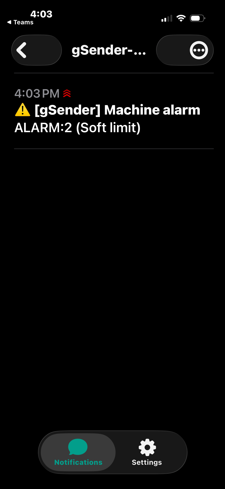 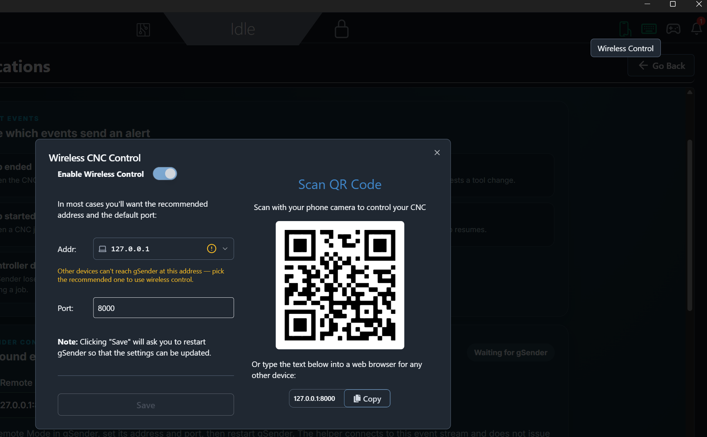 |
| [CNC Job Setup](cnc-job-setup/v0.2.46/README.md) | 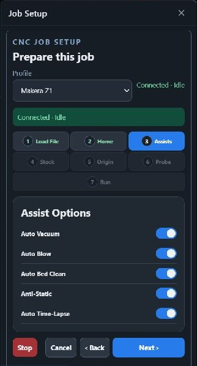 |
| [Stock & Clamp Visualizer](stock-fixture-visualizer/v0.1.0/README.md) | 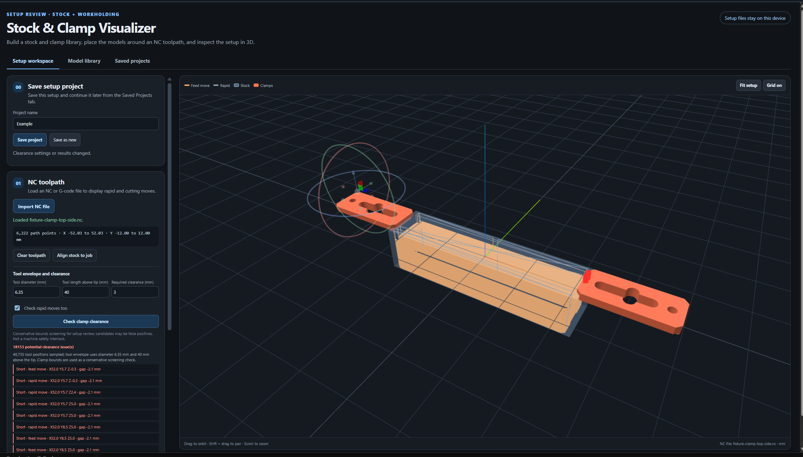 |
| [Spindle Tramming](spindle-tramming/README.md) |   |
| [Surface Height Map](surface-height-map/v0.2.3/README.md) | 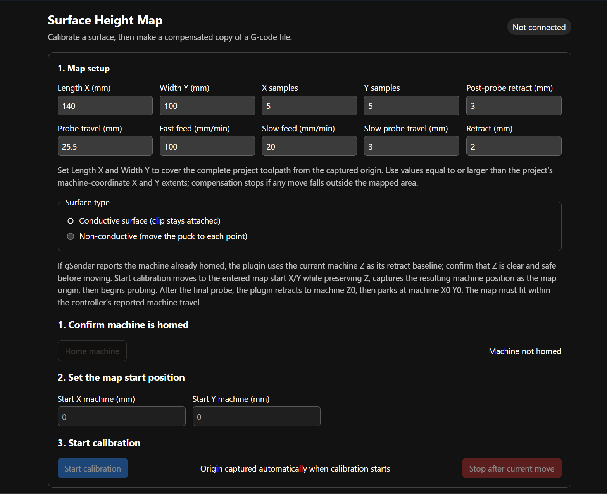 |
| [Surface Height Map (File First)](surface-height-map-file-first/v0.2.3/README.md) | 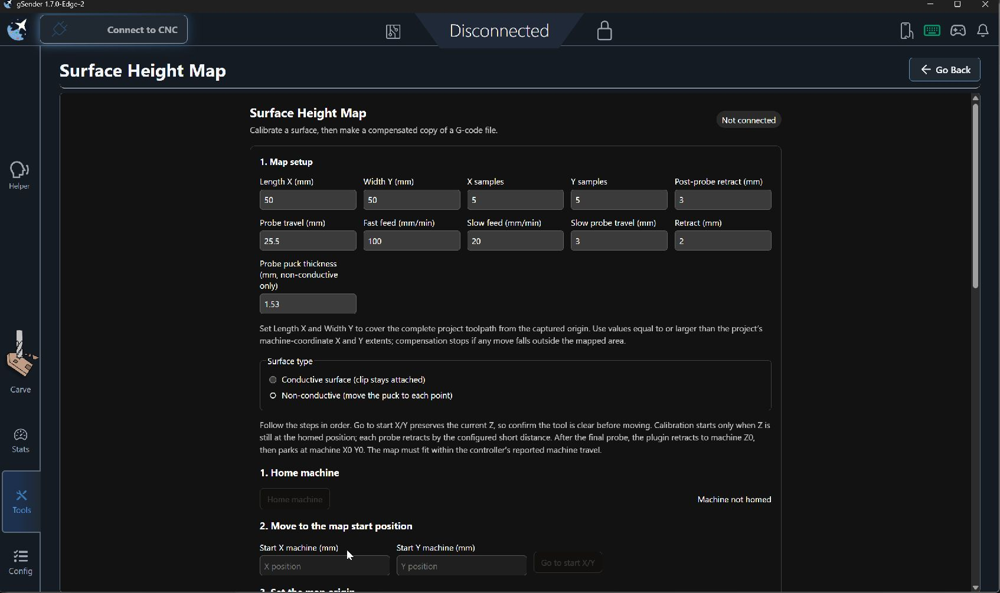 |
| [Camera Align & Print Registration](camera-align-print-registration/v0.2.18/README.md) | 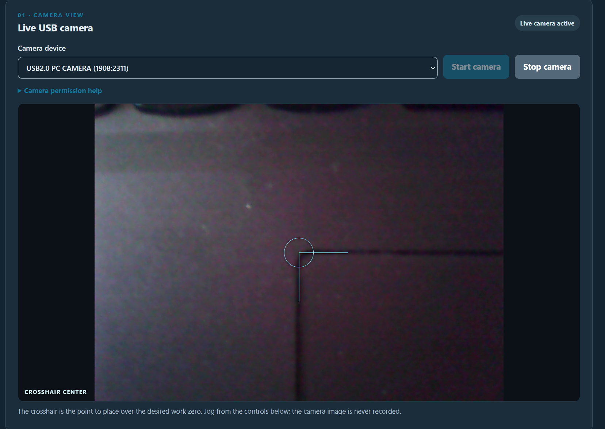 |
| [CNC Camera Monitor](camera-monitor/v0.1.12/README.md) | 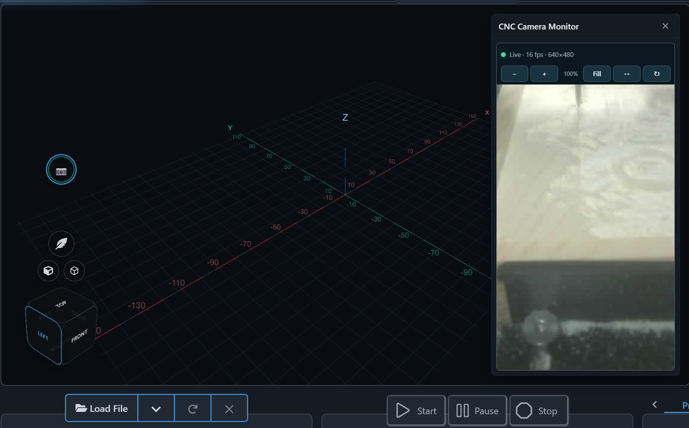 |
| [Toolpath Rotator](toolpath-rotator/v0.1.1/README.md) | 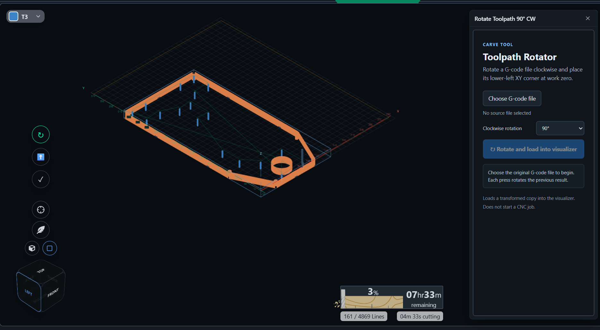 |
| [CNC Machine Diagnostics](cnc-machine-diagnostics/v0.3.7/README.md) | 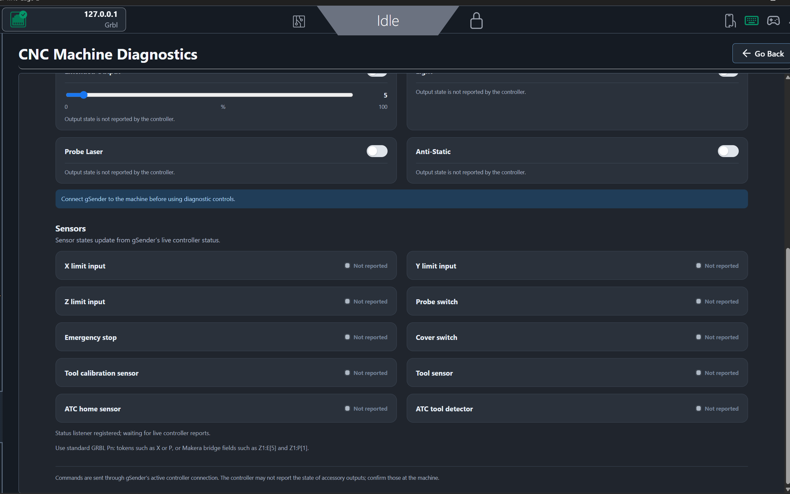 |
| [CNC Camera Monitor Local Bridge](camera-monitor-local-bridge/v0.1.0/README.md) |  |
| [G-code Job Cost Estimator](job-cost-estimator/v0.1.0/README.md) |  |
| [Basic Shape CAM](basic-shape-cam/v0.1.3/README.md) |  |
| [Heightmap Engraver](image-heightmap-engraver/v0.2.0/README.md) | 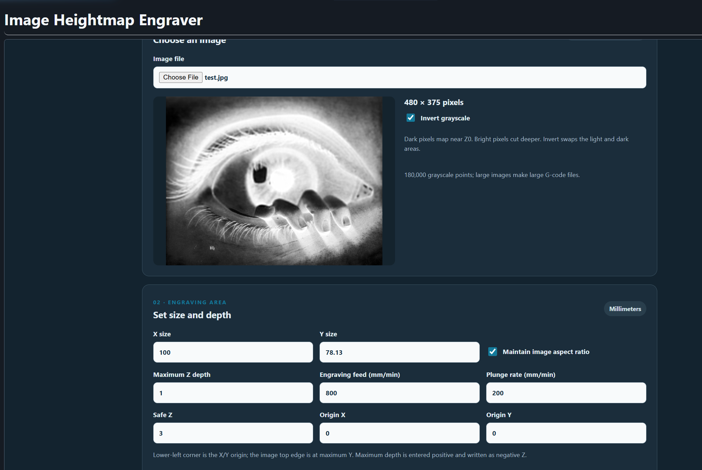  |
| [Heightmap Engraver (prototype archive)](image-heightmap-engraver/v0.1.0/README.md) |  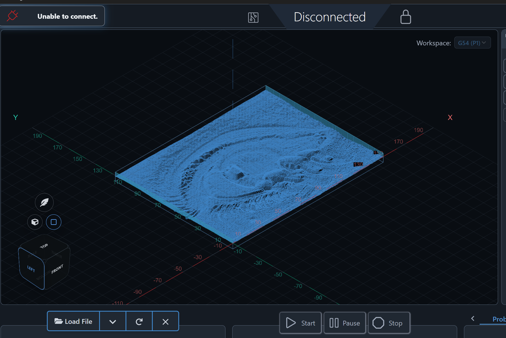 |

## Version folder layout

```text
<plugin-name>/
  v<version>/
    src/                 plugin source
    test files/          automated tests and fixtures
    ui/                  built interface for gSender
    <plugin>-v<version>.zip  install package for this version
```

Keep the matching source, built UI, manifest, README, and install ZIP together in the current version folder. Publish each version with its own Git tag and GitHub Release, then remove superseded version folders and checked-in ZIP packages from the working tree. Git tags preserve historical source snapshots. Never combine multiple plugins into one install package.

## Development

Run npm commands from the version folder you are working on. Example:

```powershell
cd surface-height-map\v0.1.39
npm ci
npm test
npm run build
.\package-plugin.ps1
```

The same workflow applies to the other plugins that provide an npm project and packaging script. Do not commit `node_modules/` or generated `dist/` contents.

## GitHub Releases

Use a separate tag and GitHub Release for each plugin or companion package version, such as `camlab-v0.1.16`, `surface-height-map-v0.2.3`, `surface-height-map-file-first-v0.2.3`, `surface-perimeter-mapper-v0.1.7`, `camera-align-print-registration-v0.2.18`, `camera-monitor-v0.1.12`, `machine-event-notifier-v0.1.21`, or `roughing-blank-planner-v0.2.1`. Attach the matching install ZIP from that version folder to its GitHub Release. Machine Event Notifications uses one combined download containing the Windows helper and its gSender plugin ZIP. The ZIP can also be downloaded directly from the repository's version folder.

