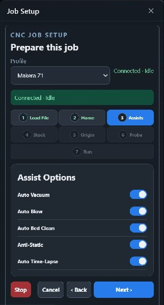

# Plugins for gSender

Source repository for gSender plugins maintained by Bakstaaj. Plugin version folders hold each current source snapshot and matching install ZIP.

## Plugins

- [CNC Job Setup](cnc-job-setup/v0.2.46/README.md) — version 0.2.46; configurable gSender streaming or Makera Z1 SD-card playback, with improved probe/tool prompts and alarm recovery.
- [Spindle Tramming](spindle-tramming/README.md) — version 0.4.4; persistent local setup settings, tilt and nod measurements for gSender 1.7.0-Edge-2.
- [Surface Height Map](surface-height-map/v0.1.22/README.md) — version 0.1.22; probe-based surface calibration and G-code compensation.
- [Surface Height Map (File First)](surface-height-map-file-first/v0.1.6/README.md) — version 0.1.6; contour-aware probing, rectangular fallback, and selectable work-zero compensation.
- [Camera Align & Print Registration](camera-align-print-registration/v0.2.0/README.md) — version 0.2.0; live camera, selectable G54–G59 work zero, and two-point printed-artwork registration.
- [CNC Camera Monitor](camera-monitor/v0.1.9/README.md) — prototype 0.1.9; USB/network camera monitoring, optional second camera, and a persistent Carve overlay with feed controls.
- [CNC Machine Diagnostics](cnc-machine-diagnostics/v0.3.2/README.md) — configurable machine profiles, controller command controls, and live sensor indicators. Includes a Makera Z1 profile.
- [CNC Camera Monitor Local Bridge](camera-monitor-local-bridge/v0.1.0/README.md) — Windows companion installer for named ONVIF/RTSP streams through go2rtc.
- [G-code Job Cost Estimator](job-cost-estimator/v0.1.0/README.md) — prototype 0.1.0; local runtime and job-cost estimates, safe-height review, and read-only XY path analysis.
- [Basic Shape CAM](basic-shape-cam/v0.1.3/README.md) — prototype 0.1.5; generate-and-load-to-visualizer for Carve review, plus downloadable profiles for rectangles, squares, circles, ovals, slots, triangles, and regular polygons.

## Plugin screenshots

| Plugin | Preview |
| --- | --- |
| [CNC Job Setup](cnc-job-setup/v0.2.46/README.md) |  |
| [Spindle Tramming](spindle-tramming/README.md) |   |
| [Surface Height Map](surface-height-map/v0.1.22/README.md) |  |
| [Surface Height Map (File First)](surface-height-map-file-first/v0.1.6/README.md) |  |
| [Camera Align & Print Registration](camera-align-print-registration/v0.2.0/README.md) |  |
| [CNC Camera Monitor](camera-monitor/v0.1.9/README.md) |  |
| [CNC Machine Diagnostics](cnc-machine-diagnostics/v0.3.2/README.md) |  |
| [CNC Camera Monitor Local Bridge](camera-monitor-local-bridge/v0.1.0/README.md) |  |
| [G-code Job Cost Estimator](job-cost-estimator/v0.1.0/README.md) |  |
| [Basic Shape CAM](basic-shape-cam/v0.1.3/README.md) |  |

## Version folder layout

```text
<plugin-name>/
  v<version>/
    src/                 plugin source
    test files/          automated tests and fixtures
    ui/                  built interface for gSender
    <plugin>-v<version>.zip  install package for this version
```

Keep the matching source, built UI, manifest, README, and install ZIP together in each version folder. For every new release, add a new version folder and preserve previous snapshots. Never combine multiple plugins into one install package.

## Development

Run npm commands from the version folder you are working on. Example:

```powershell
cd surface-height-map\v0.1.22
npm ci
npm test
npm run build
.\package-plugin.ps1
```

The same workflow applies to the other plugins that provide an npm project and packaging script. Do not commit `node_modules/` or generated `dist/` contents.

## GitHub Releases

Use a separate tag and GitHub Release for each plugin or companion package version, such as `surface-height-map-v0.1.22`, `camera-monitor-v0.1.9`, or `camera-monitor-local-bridge-v0.1.0`. Attach the matching install ZIP from that version folder to its GitHub Release. The ZIP can also be downloaded directly from the repository's version folder.

