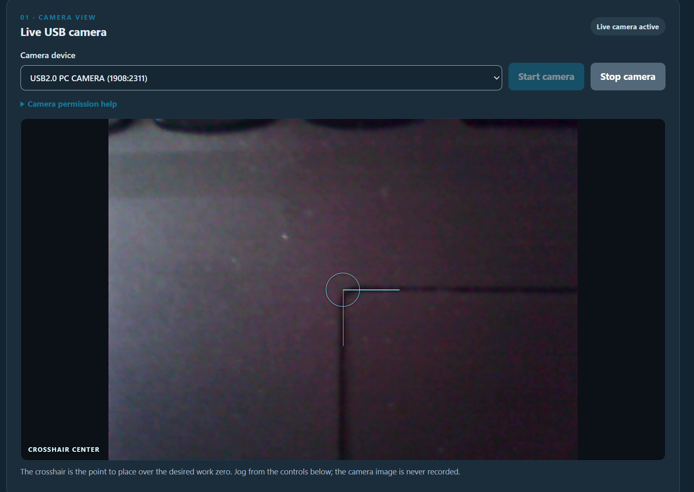
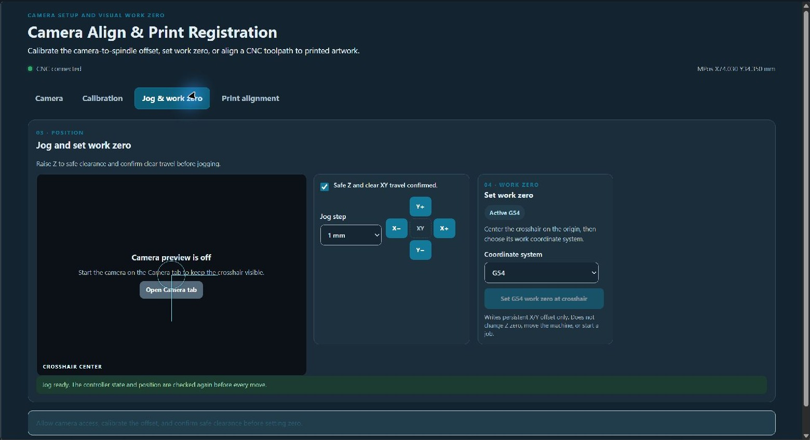
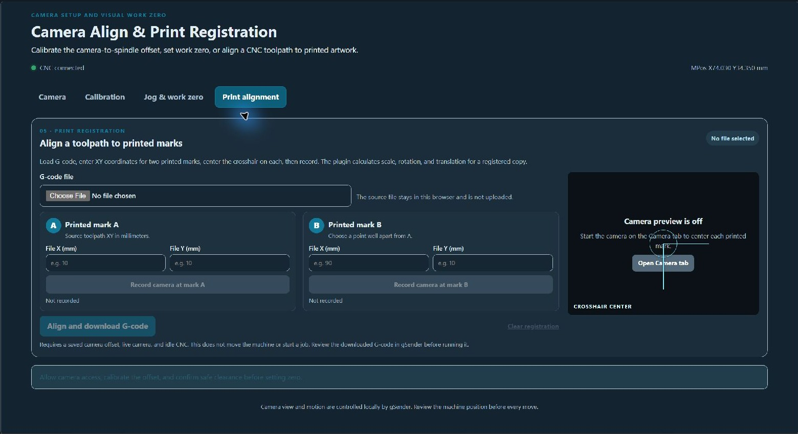
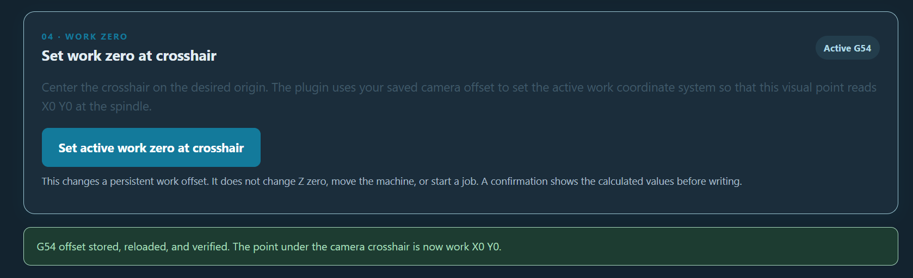

# Camera Align & Print Registration

**Version 0.2.10 · gSender 1.7.0-Edge-2 · Plugin SDK 0.2.2**

Use a live USB camera and a calibrated camera-to-spindle offset to establish work zero or align a G-code toolpath to printed artwork. The interface is organized into **Camera**, **Calibration**, **Jog & work zero**, and **Print alignment** tabs. A live crosshair preview appears on the Calibration, Jog & work zero, and Print alignment tabs after the camera starts. On the Jog & work zero tab, the camera preview sits beside the jog pad and a compact work-zero card so the controls stay together without a wide empty gap. The camera panel and jog panel can pop out together into a floating window; drag its grip to position them beside another gSender view, or dock them back. Camera images and selected G-code files stay on the computer; the plugin does not upload or record them.

Version 0.2.10 waits for the controller to finish and report each jog before restoring its motion mode, avoiding a false hold after a single increment. It also tightens the Jog & work zero layout, enlarges its camera preview, and places the jog and work-zero controls together directly beside the preview. The Print alignment tab also keeps its live preview beside the compact mark-entry form.

## Screenshots

### Live camera view

The crosshair marks the visual point placed over a work origin or printed registration mark.

### Jog & work zero layout

The updated panel keeps the camera view, jog pad, and work-zero selector together. The work-zero card is directly beside the jog controls.

### Print alignment layout

The G-code picker and two printed-mark forms sit beside the live camera preview.

### Verified work zero

The plugin reports when the selected work offset has been stored and verified.

## Print registration workflow

1. Open **Camera**, connect the USB camera, then open **Calibration** to set or measure the camera-to-spindle XY offset.
2. Load the G-code file. The file is read locally in the plugin and is limited to 25 MB.
3. Identify two points in the file that correspond to visible printed marks. Enter each point's X/Y coordinates in millimeters. Choose marks that are far apart and easy to center accurately.
4. Open **Jog & work zero**, raise Z to a safe height, and confirm clear travel. Center the camera crosshair on printed mark A and record it, then do the same for mark B. Captures are made in the current work coordinate system.
5. Select **Align and download G-code**. The plugin maps the source marks to the corresponding machine work positions, including the saved spindle-to-camera offset, and downloads a registered copy. It does not move the machine or start the job.
6. Load and review the downloaded file in gSender before running it. It begins with the work system used for capture and the controller's current units.

The alignment is a two-point similarity transform: uniform scale, rotation, and translation. It preserves orientation and does not infer mirroring. Both source points and printed points must be paired in the same order. The calculated scale must be between 0.5× and 2×.

## G-code support and limits

The aligner transforms plain numeric XY toolpath moves in the G17 plane. It supports G0/G1/G2/G3, absolute and incremental XY positioning, G20/G21 units, and I/J or R arc definitions. Z and non-XY feed/spindle commands are retained. The file's active coordinate system, if specified, must match the WCS used when the marks were recorded.

Files containing coordinate-changing features the aligner cannot preserve are rejected before download. This includes macros/expressions, checksums, subprograms, machine-coordinate moves, canned cycles, coordinate offsets, scaling, or rotation commands. Review the complete output and gSender preview before machining; firmware dialects and postprocessors vary.

## Camera offset and work zero

- Enter the spindle/tool offset manually, or measure it from the same physical reference mark with the spindle and then the camera crosshair.
- The offset convention is spindle XY minus camera-crosshair XY.
- In **Jog & work zero**, set the jog step, confirm safe Z and clear XY travel, and use the XY buttons to position the crosshair.
- Jog buttons enable when gSender is connected and the safe-travel checkbox is checked. Before every move, the plugin checks that gSender and the controller are idle and that a machine position is available; an unmet check blocks the move and reports why.
- Select G54–G59 in that same panel and use **Set work zero at crosshair** to update the selected persistent X/Y offset. The plugin confirms the write and checks the controller's offset table. A live position check is performed when changing the active system.
- The G54 crosshair work-zero flow has been confirmed on a live CNC. The non-active WCS branch, full-travel jogging, and print-registration output still need machine-side validation.

## Camera access and safety

- Approve Camera and media permissions when gSender prompts. The plugin requests video only, not microphone audio.
- If access is denied, expand **Camera access diagnostics** to inspect browser permission and plugin-frame camera policy.
- The camera and spindle must remain rigidly mounted. Check camera, spindle, cable, and clamp clearance throughout the machine's full XY travel before jogging.
- Jog controls enable only when gSender is connected, reports a machine position, the controller and gSender are idle, and the safe-travel checkbox is checked. The panel reports which condition is still needed.
- Registration mark capture requires an idle CNC and the safe-Z/clear-travel acknowledgement. Recording a mark reads position only; it does not move the machine.
