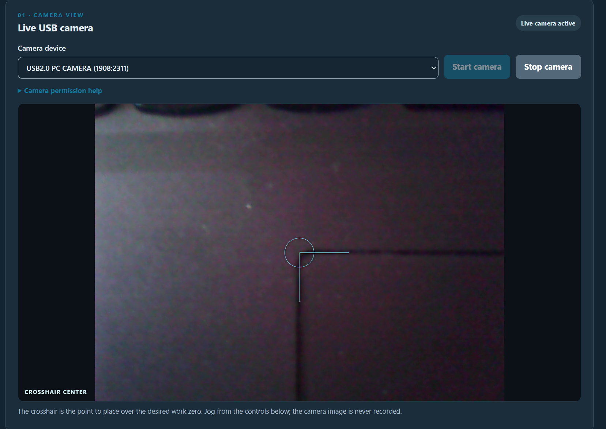
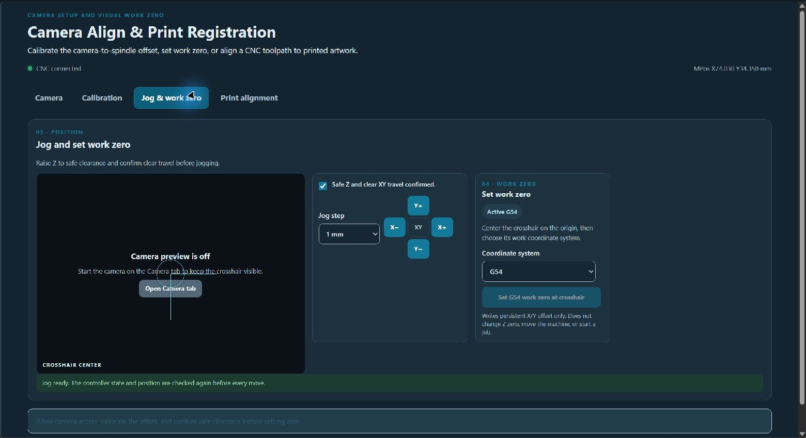
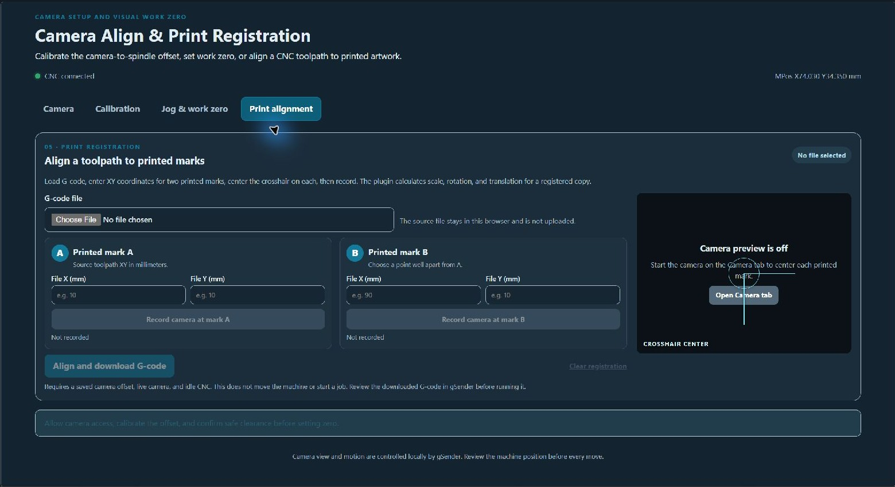
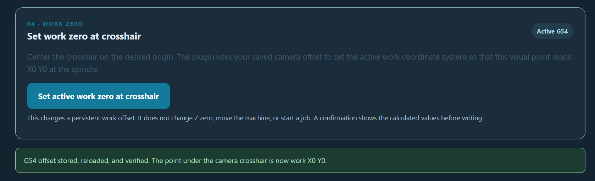

# Camera Align & Print Registration
**Latest release package:** [Download camera-align-print-registration-v0.2.18.zip](https://github.com/bakstaaj/gSender-Plugins/releases/download/camera-align-print-registration-v0.2.18/camera-align-print-registration-v0.2.18.zip)

**Version 0.2.18 · gSender 1.7.0-Edge-2 · Plugin SDK 0.2.2**

Use a live USB camera and a calibrated camera-to-spindle offset to establish work zero or align a G-code toolpath to printed artwork. The interface is organized into **Camera**, **Calibration**, **Jog & work zero**, and **Print alignment** tabs. A compact **Align** tab in the Carve window shows the live crosshair, WCS selector, and X/Y zero action; it uses Carve's existing jog controls and does not duplicate them. A live crosshair preview also appears on the Calibration, Jog & work zero, and Print alignment tabs after the camera starts. The camera panel and jog panel can pop out together into a floating window; drag its grip to position them beside another gSender view, or dock them back. Camera images and selected G-code files stay on the computer; the plugin does not upload or record them.

Version 0.2.18 adds configurable crosshair appearance, optional macro work-zero actions with confirmation controls, picture-in-picture camera preview, automatic camera restart, and a visualizer overlay. It includes the standard bakStaaJ Designs copyright footer. Version 0.2.17 layers the Align toolbar over the full camera view; collapsing it leaves only the open chevron over the expanded preview. Version 0.2.16 aligns the toolbar using explicit controls in a single row, keeps the WCS label beside its selector, and removes unused grid space. Version 0.2.15 places a centered SVG collapse control at the far left and caps the X/Y zero button width. Version 0.2.14 makes the collapsed toolbar a compact chevron and moves status feedback into temporary overlays instead of a permanent panel below the camera. Version 0.2.13 lays out the Carve **Align** tab with a single-row toolbar above a full-width camera view. The toolbar can collapse to give the preview more space. Version 0.2.12 added the Carve tab without duplicating the host jog controls. Version 0.2.11 fixes the measured camera-to-spindle offset sign so reference-mark calibration matches manual entry. It retains the jog-completion wait from v0.2.10, which prevents a normal one-step move from being mistaken for a failed jog.

## Screenshots

### Live camera view

The crosshair marks the visual point placed over a work origin or printed registration mark.

### Jog & work zero layout

The updated panel keeps the camera view, jog pad, and work-zero selector together. The work-zero card is directly beside the jog controls.

### Print alignment layout

The G-code picker and two printed-mark forms sit beside the live camera preview.

### Verified work zero

The plugin reports when the selected work offset has been stored and verified.

## Print registration workflow

1. Open **Camera**, connect the USB camera, then open **Calibration** to set or measure the camera-to-spindle XY offset.
2. Load the G-code file. The file is read locally in the plugin and is limited to 25 MB.
3. Identify two points in the file that correspond to visible printed marks. Enter each point's X/Y coordinates in millimeters. Choose marks that are far apart and easy to center accurately.
4. Open **Jog & work zero**, raise Z to a safe height, and confirm clear travel. Center the camera crosshair on printed mark A and record it, then do the same for mark B. Captures are made in the current work coordinate system.
5. Select **Align and download G-code**. The plugin maps the source marks to the corresponding machine work positions, including the saved spindle-to-camera offset, and downloads a registered copy. It does not move the machine or start the job.
6. Load and review the downloaded file in gSender before running it. It begins with the work system used for capture and the controller's current units.

The alignment is a two-point similarity transform: uniform scale, rotation, and translation. It preserves orientation and does not infer mirroring. Both source points and printed points must be paired in the same order. The calculated scale must be between 0.5× and 2×.

## G-code support and limits

The aligner transforms plain numeric XY toolpath moves in the G17 plane. It supports G0/G1/G2/G3, absolute and incremental XY positioning, G20/G21 units, and I/J or R arc definitions. Z and non-XY feed/spindle commands are retained. The file's active coordinate system, if specified, must match the WCS used when the marks were recorded.

Files containing coordinate-changing features the aligner cannot preserve are rejected before download. This includes macros/expressions, checksums, subprograms, machine-coordinate moves, canned cycles, coordinate offsets, scaling, or rotation commands. Review the complete output and gSender preview before machining; firmware dialects and postprocessors vary.

## Camera offset and work zero

- Enter the spindle/tool offset manually, or measure it from the same physical reference mark with the spindle and then the camera crosshair.
- The offset convention is the spindle physical position relative to the camera crosshair. Reference-mark calibration calculates the camera-recorded machine XY minus the spindle-recorded machine XY, matching manual offset values.
- In **Jog & work zero**, set the jog step, confirm safe Z and clear XY travel, and use the XY buttons to position the crosshair.
- Jog buttons enable when gSender is connected and the safe-travel checkbox is checked. Before every move, the plugin checks that gSender and the controller are idle and that a machine position is available; an unmet check blocks the move and reports why.
- Select G54–G59 in that same panel and use **Set work zero at crosshair** to update the selected persistent X/Y offset. The plugin confirms the write and checks the controller's offset table. A live position check is performed when changing the active system.
- The G54 crosshair work-zero flow has been confirmed on a live CNC. The non-active WCS branch, full-travel jogging, and print-registration output still need machine-side validation.

## Crosshair and work-zero button settings

Open **Crosshair & work-zero button settings** on the **Camera** tab. Settings are saved in the plugin's gSender storage and apply to every camera preview.

- **Color**, **Shape** (full cross or the original corner/L shape), **Arm length** (pixels from the center to each tip), **Center gap** (pixels left open around the center; 0 for none), and **Show circle**.
- **Work-zero button**: keep the built-in verified G10 X/Y write, or run a gSender macro instead. The macro list is read from gSender's macros. The plugin checks that gSender is connected and idle and asks for confirmation before running the macro. The macro then runs as written. Tick **Don't ask again before running this macro** in the dialog to skip the confirmation for that macro. **Ask for confirmation before running the macro** in the settings turns it back on. Choosing a different macro always asks again. The connected/idle check still runs every time.
- Macros can use these variables: `[cam_offset_x]` and `[cam_offset_y]` (saved spindle offset from the crosshair in mm; 0 when not calibrated), `[cam_wcs]` (the selected WCS, e.g. `"G54"`), and `[cam_wcs_p]` (its G10 P index, 1–6). Example: `G21 G10 L20 P[cam_wcs_p] X[cam_offset_x] Y[cam_offset_y]`.
- **Open picture-in-picture when the camera starts** and **Restart the camera automatically when this view opens again** (on by default). See below.
- **Camera resolution:** Maximum the camera supports, 1080p (default), 720p or 480p. Without a requested size, Chromium usually opens cameras at 640 × 480. The camera status shows the size actually delivered, e.g. *Live camera · 1920 × 1080*. A running camera restarts when you change this setting. Higher resolutions can lower the frame rate of some USB cameras.

## Picture-in-picture, camera restart and view layouts

- **Picture-in-picture:** the **Picture-in-picture** / **PiP** buttons show the camera image with the crosshair in a floating window. You can move and resize the window freely, and it stays above gSender. The window shows the image only; use the plugin or gSender for jogging and work zero. Browsers only open it after a click, so it cannot reopen by itself after an automatic camera restart. Its size and position are kept for the current gSender session only.
  - The PiP image is drawn at the window's on-screen size, so the crosshair stays as thin as in the plugin when you enlarge the window.
  - **Zoom** (1×, 1.5×, 2×, 3×, 4×) enlarges the center around the crosshair. Use the ⏭ (zoom in) and ⏮ (zoom out) buttons inside the PiP window. The window can only show the browser's media buttons, so these "track" buttons are reused for zoom. Or use the **− PiP 2× +** controls that appear in the plugin while PiP is open. Zoom changes the picture only and never sends anything to the machine. The last zoom level is remembered.
- **Camera restart:** gSender unloads the plugin when you leave its tab (for example, switching to Macros). If the camera was running, the plugin restarts it with the same device when the view opens again, also after restarting gSender. Stopping the camera yourself turns this off until you start it again.
- **Align tab (Carve tools area):** when the area is low and at least as wide as it is high, the camera fills the height on the left, and the controls stack on the right. Each control is 22–48 px high, depending on the available height.
- **Camera Align button over the visualizer (🎯):** opens gSender's overlay panel with the camera on top and the controls below. By default the image fills the panel, which crops the sides and enlarges the center. **Show whole image** switches back to the uncropped image. While picture-in-picture is open, the panel hides its own image and enlarges the controls.
- The overlay panel and the Align tab are separate plugin instances. If both are open, both use the camera.

## Camera access and safety

- Approve Camera and media permissions when gSender prompts. The plugin requests video only, not microphone audio.
- If access is denied, expand **Camera access diagnostics** to inspect browser permission and plugin-frame camera policy.
- The camera and spindle must remain rigidly mounted. Check camera, spindle, cable, and clamp clearance throughout the machine's full XY travel before jogging.
- Jog controls enable only when gSender is connected, reports a machine position, the controller and gSender are idle, and the safe-travel checkbox is checked. The panel reports which condition is still needed.
- Registration mark capture requires an idle CNC and the safe-Z/clear-travel acknowledgement. Recording a mark reads position only; it does not move the machine.
