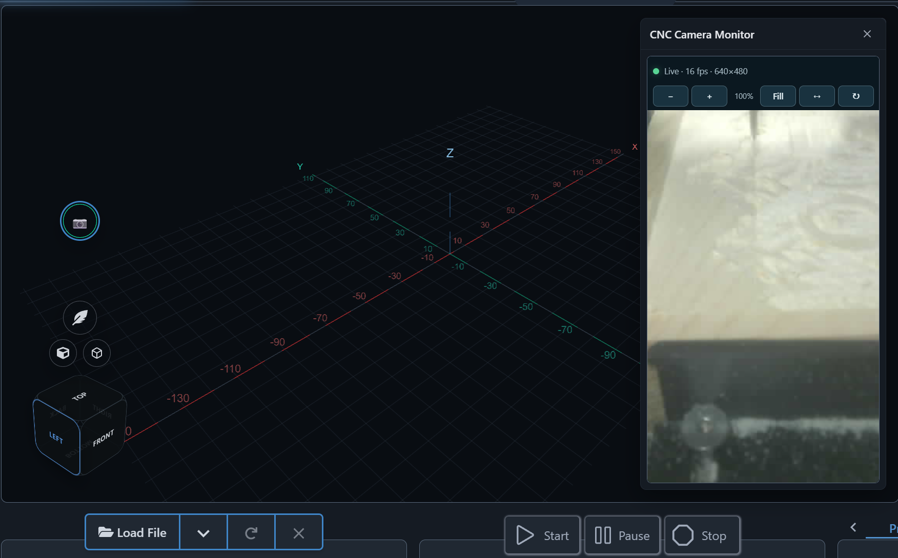

# CNC Camera Monitor
**Latest release package:** [Download camera-monitor-v0.1.11.zip](https://github.com/bakstaaj/gSender-Plugins/releases/download/camera-monitor-v0.1.11/camera-monitor-v0.1.11.zip)

The latest source snapshot and install package are in [version 0.1.11](v0.1.11/README.md). The plugin shows USB and supported network camera feeds in gSender, including an optional second camera and a view-only overlay over the Carve workspace. The Carve Camera tab has a collapsible toolbar, and the preview has no alignment crosshair.

For ONVIF or RTSP cameras, install the separate [CNC Camera Monitor Local Bridge](../camera-monitor-local-bridge/v0.1.0/README.md). The bridge runs outside gSender and restreams named feeds through go2rtc for browser playback.

See the [plugin guide](v0.1.11/README.md) for setup, supported camera sources, two-camera configuration, and screenshots.
