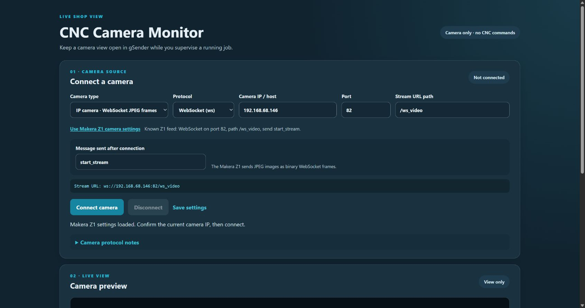
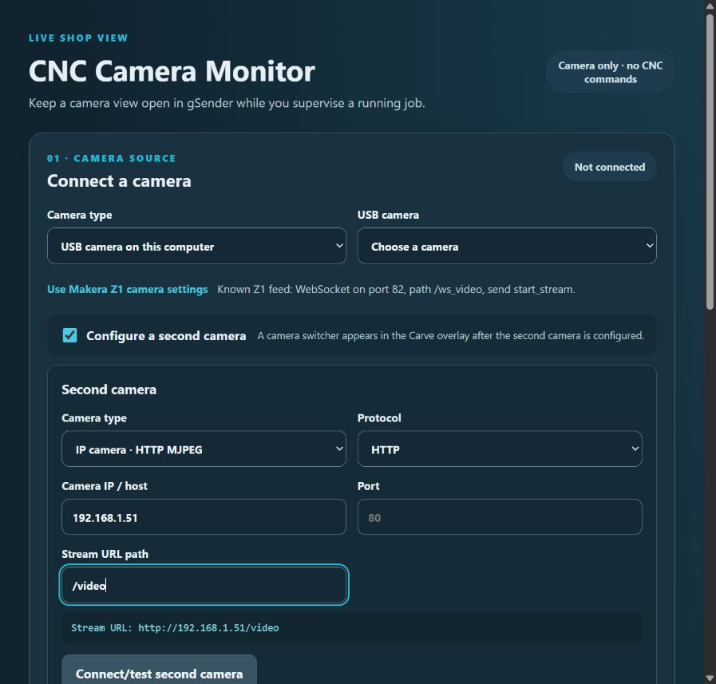

# CNC Camera Monitor
**Latest release package:** [Download camera-monitor-v0.1.11.zip](https://github.com/bakstaaj/gSender-Plugins/releases/download/camera-monitor-v0.1.11/camera-monitor-v0.1.11.zip)

**Prototype 0.1.11 · gSender 1.7.0-Edge-2 · Plugin SDK 0.2.2**

A view-only camera plugin for monitoring USB and compatible network camera feeds while gSender runs a CNC job. In Carve, its controls overlay the live preview and collapse to a small chevron so the camera can use the full tab area. The preview has no center crosshair; use Camera Align & Print Registration for alignment. It does not access machine controls, send G-code, or change job state.

## Screenshot

The Makera Z1 preset fills the editable IP camera settings and shows the connection URL before the user connects.

## Camera sources

- **USB camera:** uses the computer’s browser camera permission and media capture.
- **HTTP MJPEG:** displays a multipart JPEG stream from an IP camera.
- **JPEG snapshots:** refreshes one JPEG URL at a chosen interval.
- **WebSocket JPEG:** receives binary JPEG frames and can send a text start command.
- **Browser video URL:** uses codecs supported by the Chromium build embedded in gSender. HLS support varies by build.
- **Local RTSP bridge:** a separate Windows companion runs go2rtc locally and displays ONVIF/RTSP camera streams through its browser-compatible WebRTC viewer. See the [Local Bridge setup guide](https://github.com/bakstaaj/gsender_plugins/blob/main/camera-monitor-local-bridge/v0.1.0/README.md).

## View the camera over Carve

Configure the camera from the Tools page. A successful connection saves the selected camera settings automatically. In Carve, the **Camera** tab in the lower-right panel reconnects using those saved settings and shows a compact live view with connect/disconnect, feed health, camera switching, zoom, fit, flip, and rotate controls. The feed is view-only and does not start, pause, stop, or change the CNC job.

## ONVIF and RTSP using the local bridge

Browsers do not play RTSP directly. Extract the separate [CNC Camera Monitor Local Bridge](https://github.com/bakstaaj/gsender_plugins/blob/main/camera-monitor-local-bridge/v0.1.0/README.md) ZIP and double-click **Install Camera Bridge.cmd**. The installer copies it to `C:\rtsp_bridge`, creates a Desktop shortcut, and starts the bridge. When you choose **Local RTSP / ONVIF bridge**, the plugin shows the install/start guidance and a **Configure cameras** panel that embeds go2rtc's local page at `http://127.0.0.1:1984/`.

In the bridge page, use **add** to discover/test ONVIF cameras, then use **config** to save a named stream and click **Save & Restart**. For example, save a source as `cam1` in go2rtc's YAML configuration. In Camera Monitor, click **Use local RTSP bridge**, set the viewer path to `/stream.html?src=cam1&mode=webrtc&background=false`, then click **Connect camera**. The name in `src=` must match the stream name in go2rtc. For a second camera, save it as `cam2` and use `src=cam2` in the second profile. Follow the bridge README for the full ONVIF/RTSP examples and setup steps.

The bridge viewer reports its own stream errors inside the preview; the plugin can detect that the viewer page loaded, but cannot read its internal frame rate or video dimensions.

The Camera tab shows feed health and image controls. MJPEG sources are marked connected because Chromium does not expose reliable per-frame timing for those streams. The view defaults to Fill; Fit, zoom, flip, and rotate controls remain available.

### Makera Z1

Choose **Use Makera Z1 camera settings**, confirm the current camera IP, then connect. The preset reflects the known feed:

- WebSocket URL: ws://192.168.68.146:82/ws_video
- Start text: start_stream
- Incoming data: binary JPEG frames

The address is editable because the machine’s IP can change. A successful connection in another client does not guarantee the gSender plugin frame or camera firmware will accept its WebSocket origin; confirm this on the target setup.

## Optional second camera

On the Tools page, select **Configure a second camera**, choose its source type, and enter the USB device or network stream details. Connect/test the second camera to confirm its feed. Once enabled and configured, **Camera 1** and **Camera 2** buttons appear in the Carve Camera tab; if the second camera is disabled or incomplete, the switcher stays hidden. Both camera profiles are saved in gSender plugin storage.

The screenshot uses an example MJPEG address (`192.168.1.51/video`) to show the fields; it is not a connected camera. Use your camera’s actual stream address. The switcher appears after the second profile is enabled and has a valid source.

For two cameras through the Local Bridge, create two go2rtc streams with distinct names, such as `cam1` and `cam2`. Use **Use local RTSP bridge** in each profile, then edit the path’s `src` value so Camera 1 uses `/stream.html?src=cam1&mode=webrtc&background=false` and Camera 2 uses `/stream.html?src=cam2&mode=webrtc&background=false`. The names in the plugin paths must match the stream names configured in go2rtc. See the [two-camera bridge example](https://github.com/bakstaaj/gsender_plugins/blob/main/camera-monitor-local-bridge/v0.1.0/README.md#use-two-cameras).

## Network camera setup

Set the protocol, camera IP or host, port, and stream path. The displayed URL is assembled from these values. For example, an HTTP MJPEG camera might use http://192.168.1.50:8080/video.

Camera brands vary in URL paths, authentication, codecs, and firmware. Use the stream endpoint documented by your camera. This plugin does not discover IP cameras or bypass camera credentials.

**RTSP does not play directly in a browser.** The Local Bridge uses go2rtc to display RTSP/ONVIF streams in its built-in WebRTC viewer, including common H.264 feeds without converting them to MJPEG. Browser HLS playback depends on the installed Chromium build and is not guaranteed.

Direct network feeds may also be affected by gSender’s plugin-frame network policy, the computer firewall, HTTPS/mixed-content rules, or a camera that rejects browser-originated connections. USB uses Camera/media permission; network access relies on the app and camera allowing the connection.

## Safety and privacy

- The camera panel is view-only and independent of CNC job controls.
- The plugin does not start, pause, stop, or alter a CNC job.
- Video frames are held in the current gSender view and are not recorded or uploaded by this plugin.
- Camera settings are stored with gSender plugin storage.
- Use the normal machine controls and direct observation to supervise a running CNC.

## Development

From this version folder, run npm ci and npm run build. Import the built ui/ folder with gsender-plugin.json through the gSender plugin manager. This version targets gSender 1.7.0-Edge-2.

This is an initial implementation. USB behavior, camera permissions, MJPEG endpoints, network policy, and the Makera Z1 WebSocket must be verified in the target gSender installation and on the camera’s network.
