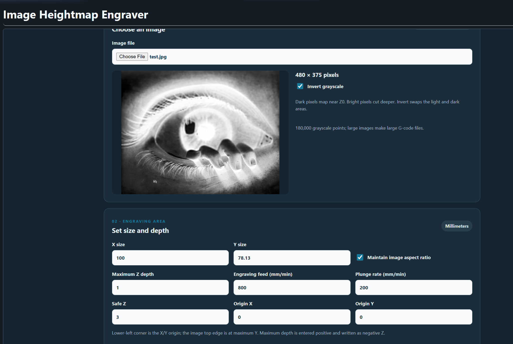
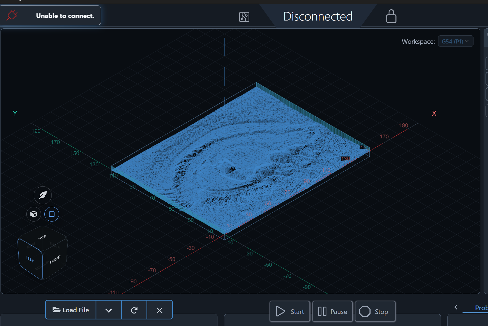

# Image Heightmap Engraver
**Latest release package:** [Download image-heightmap-engraver-v0.1.4.zip](https://github.com/bakstaaj/gSender-Plugins/releases/download/image-heightmap-engraver-v0.1.4/image-heightmap-engraver-v0.1.4.zip)

Prototype version 0.1.0 for gSender 1.7.0-Edge-2. Converts an uploaded image to 8-bit grayscale and generates a serpentine raster heightmap G-code file.

## Screenshots

Set the engraving dimensions and maximum depth, then generate a grayscale raster toolpath.

Load the generated file into gSender Carve to inspect the heightmap surface before machining.

## Image and Z mapping

0 maps to Z0 at the surface; 255 maps to the entered maximum depth below the surface. Enter maximum depth as a positive millimeter value; output Z coordinates are negative. Invert grayscale swaps light and dark. Maintain image aspect ratio is on by default. The lower-left corner uses the entered origin and the image top is at maximum Y.

## Output and limitations

Generate G-code, then load it into the gSender visualizer for Carve review, export `.nc`, or copy the G-code to the clipboard. Visualizer loading replaces the currently loaded file but does not start a CNC job. The file uses millimeters, absolute coordinates, XY plane, feed-per-minute mode, and G54.

One sample per source pixel is emitted. Images over 300,000 pixels are rejected to keep files manageable. Tool diameter, feeds and speeds, machine travel, stock, fixtures, and workholding are not checked. Review and simulate before machining.

## Install

Run `npm ci`, `npm run build`, then `package-plugin.ps1` from this version folder. Import `image-heightmap-engraver-v0.1.0.zip` with gSender's plugin manager and approve Visualizer Load permission.
