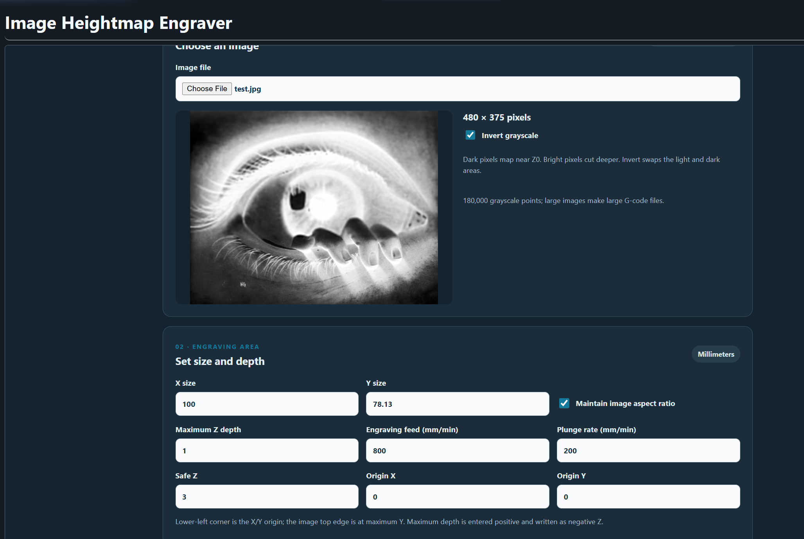
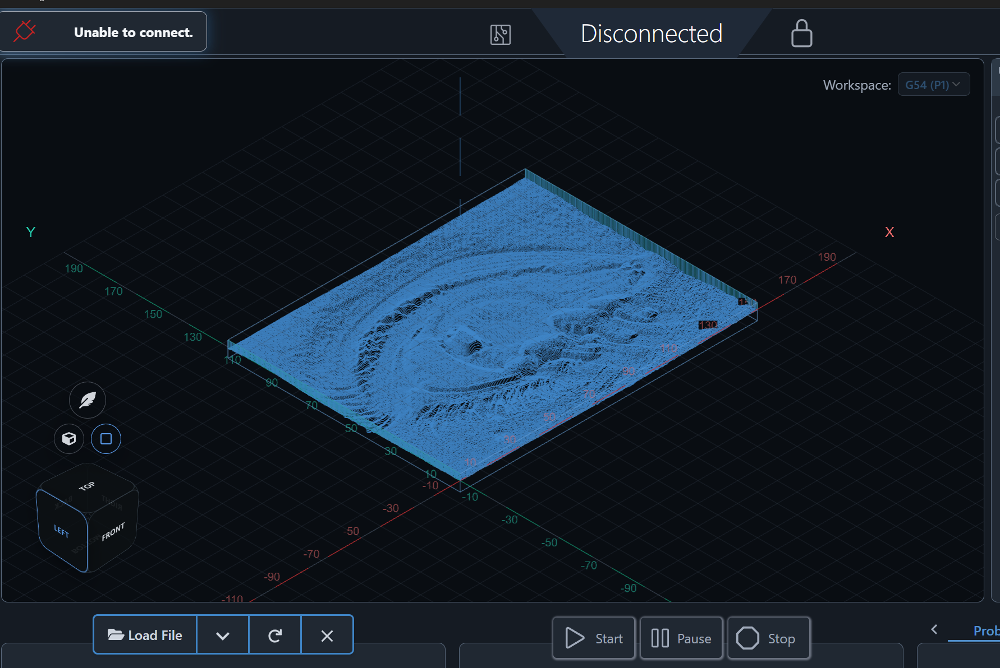

# Image Heightmap Engraver
**Latest release package:** [Download image-heightmap-engraver-v0.1.9.zip](https://github.com/bakstaaj/gSender-Plugins/releases/download/image-heightmap-engraver-v0.1.9/image-heightmap-engraver-v0.1.9.zip)

Version 0.1.9 for gSender 1.7.0-Edge-2. Converts an uploaded image to 8-bit grayscale and generates raster or elliptical spiral heightmap G-code for review in gSender Carve.

## Screenshots

Set the engraving dimensions and maximum depth, then generate a grayscale raster toolpath.

Load the generated file into gSender Carve to inspect the heightmap surface before machining.

## Image and Z mapping

The lowest grayscale value found in the loaded image maps to Z0 at the surface, and the highest value found maps to the entered maximum depth below the surface. Other values are scaled proportionally across that image-specific range. For a flat image with one grayscale value, all points map to Z0. Enter maximum depth as a positive millimeter value; output Z coordinates are negative. Invert grayscale swaps light and dark before the image range is measured. Maintain image aspect ratio is on by default. Without a frame, the image lower-left uses the entered origin. With a frame, the outer lower-left corner uses the entered origin and the image begins 5 mm inside it.

## Output and limitations

Generate G-code, then load it into the gSender visualizer for Carve review, export `.nc`, or copy the G-code to the clipboard. The G-code header reports the image's measured grayscale range and its Z mapping. Visualizer loading replaces the currently loaded file but does not start a CNC job. The file uses millimeters, absolute coordinates, XY plane, feed-per-minute mode, and G54.

Set the spindle slider from 0 to 20,000 RPM in 100 RPM increments; the default is 10,000 RPM. A value above zero starts the spindle with `M3 S…`; zero explicitly leaves it off with `M5`. The controller must be configured so its spindle `S` range represents RPM.

The optional **Add 5 mm Z0 frame** checkbox adds two outline paths after the raster. The outer outline is 5 mm beyond each image edge and its lower-left corner is the X/Y origin. The inner outline follows the image boundary with 1.5 mm rounded corners. Both outlines are at Z0. The frame is off by default.

One sample per output pixel is emitted, up to 300,000 points. Larger images are automatically scaled down while preserving their aspect ratio so they fit the point limit.

Two-tool mode is enabled by default. It roughs with a 1/8 inch (3.175 mm) flat endmill, using a conservative square tool envelope and leaving the configured stock allowance (0.3 mm by default). It then stops with `M0` for a manual change to the 60° V-bit with 0.1 mm tip. Before resuming, set work Z0 to the original stock surface. The same feed, plunge, and spindle settings are used for both operations. Disable two-tool mode for a single V-bit raster. The roughing envelope is deliberately conservative and may leave extra stock around diagonal details. Optionally enable a third pass to finish again at 90° to the first raster; this can reduce directional ridges at the cost of roughly doubling finish time. Confirm the controller supports `M0`, inspect the complete output, and simulate before machining. Tool geometry, feeds and spindle RPM, machine travel, stock, fixtures, and workholding are not otherwise checked.

Images with a clear oval boundary against a consistent corner background or transparency are detected automatically. Background outside the detected oval maps to Z0; the first V-bit finish pass uses an interpolated center-out elliptical spiral. Ambiguous images keep the normal raster finish. Check the detected outline in the preview before generating G-code. The optional third pass remains a perpendicular raster.

Image dimensions, depth, feeds, spindle speed, origin, roughing allowance, and operation checkboxes are saved in local browser storage. The uploaded image must be selected again after reopening the plugin. The default spindle speed is 10,000 RPM; confirm that value is suitable for the spindle, material, and tool before machining.

## Install

Run `npm ci`, `npm run build`, then `package-plugin.ps1` from this version folder. Import `image-heightmap-engraver-v0.1.9.zip` with gSender's plugin manager and approve Visualizer Load permission.
