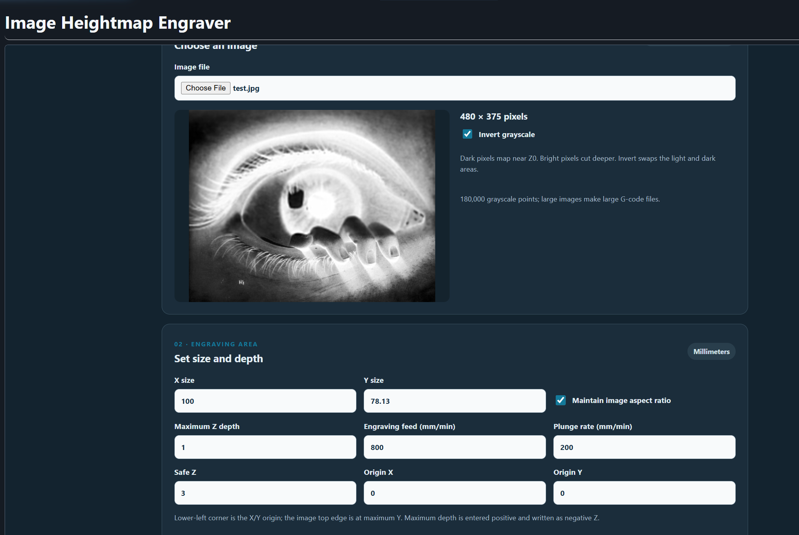
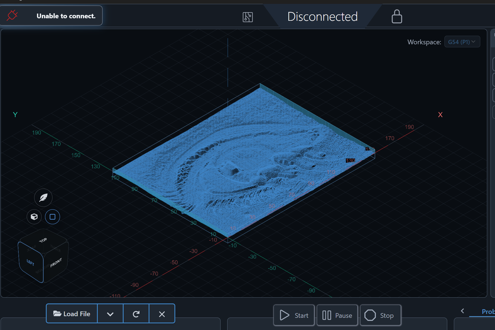

# Heightmap Engraver
**Latest published release:** [Download image-heightmap-engraver-v0.2.0.zip](https://github.com/bakstaaj/gSender-Plugins/releases/download/image-heightmap-engraver-v0.2.0/image-heightmap-engraver-v0.2.0.zip)

Version 0.2.0 for gSender 1.7.0-Edge-2. Generates selectable toolpaths from an image, directly from an STL/STEP topography, or from an image draped over an STL/STEP top surface.

## Screenshots

Set the engraving dimensions and maximum depth, then generate a grayscale raster toolpath.

Load the generated file into gSender Carve to inspect the heightmap surface before machining.

## Image and Z mapping

The darkest grayscale value adds no relief; the brightest value cuts to the selected maximum depth below the starting surface on flat-image jobs. Other values are scaled proportionally across that image-specific range. With a model loaded, Maximum Depth instead clips the combined model and image target below model Z0. Invert grayscale swaps light and dark before the image range is measured. Images are converted to grayscale; color is not reproduced by the CNC toolpath. Maintain image aspect ratio is on by default.

## Engrave on an STL or STEP top surface

Load an STL, STP, or STEP file by itself to generate a toolpath directly from its topography, or also load an image to overlay image relief on the model. The model's highest Z is work Z0. When a model is loaded, Maximum Depth clips the combined model/image target so no cut goes deeper than that amount below model Z0. STL coordinates are treated as millimeters. STEP geometry is tessellated in the browser and converted to millimeters. Orient the face to engrave toward +Z.

Surface sampling includes only upward-facing triangles within the selected maximum slope from horizontal. Uncovered grid cells, underside faces, and steeper walls are skipped; toolpaths retract and restart around gaps they cannot safely link. The model's XY size is fixed to its imported bounds. This is a top-view height field and does not support undercuts or side engraving. Relief depth is measured in machine Z, not along the surface normal. For model-only mode, set work Z0 to the model's highest point; sampled heights deeper than Maximum Depth are clipped to that limit.

## Output and limitations

Choose a finish path algorithm:

- **Automatic** uses an inside-out 3D relief spiral for model-only work, keeps the detected oval spiral for oval images, and uses raster for other images.
- **Raster / Parallel** follows one direction. Finish stepover controls the spacing between T2 finish rows.
- **Crosshatch** adds a perpendicular finish direction to reduce directional ridges, with roughly twice the finishing time.
- **3D Relief Parallel** uses reciprocating rows without retracting between adjacent passes when the top-surface mask is continuous, following Makera's documented parallel strategy.
- **3D Relief Spiral (inside-out / outside-in)** links nested elliptical passes into a continuous spiral in the selected direction and clips them to valid top-surface cells. It retracts when a gap in the sampled surface prevents a safe link.
- **Elliptical Spiral** generates a center-out spiral. Corners may remain uncut on rectangular or irregular areas.

These paths follow the visible Makera 3D Relief spiral style and documented Parallel/Offset strategy choices; they do not reproduce Makera Studio's proprietary toolpath engine. Spiral paths use nested ellipses, so irregular model boundaries may not be followed exactly.

Generate G-code, then load it into the gSender visualizer and open Carve for review, save `.nc` with the native file-save dialog, or copy the G-code to the clipboard. The G-code header reports the algorithm, stepover, image mapping or direct model-height mapping, and model Z reference when used. Visualizer loading replaces the currently loaded file but does not start a CNC job. The file uses millimeters, absolute coordinates, XY plane, feed-per-minute mode, and G54.

Set the spindle slider from 0 to 20,000 RPM in 100 RPM increments; the default is 10,000 RPM. A value above zero starts the spindle with `M3 S…`; zero explicitly leaves it off with `M5`. The controller must be configured so its spindle `S` range represents RPM.

The optional **Add 5 mm Z0 frame** checkbox is available in flat image mode. It adds two outline paths after the relief. The outer outline is 5 mm beyond each image edge and its lower-left corner is the X/Y origin. The inner outline follows the image boundary with 1.5 mm rounded corners. Both outlines are at Z0. The frame is off by default.

Choose a maximum image sampling limit of 300K, 500K, 750K, 1M, 1.5M, or 2M points. The default is 300K. Larger files are scaled down while preserving aspect ratio; changing the limit reprocesses the currently loaded image. Higher limits can preserve finer image and model detail but increase processing time, memory use, and G-code size. Raster row spacing is controlled by stepover, while along-row sampling follows the pixel resolution. The input grid also limits how finely the model surface can be sampled. STL and STEP models are stored as packed numeric triangle data and can contain up to six million triangles; larger meshes still need to be simplified or retessellated.

Two-tool mode is enabled by default. It selects T1 (`T1 M6`) for the 1/8 inch (3.175 mm) flat-endmill roughing pass. Roughing always uses a reciprocating zigzag with 50% overlap, for a nominal 1.588 mm centerline stepover, and leaves the configured stock allowance (0.3 mm by default). The **Finish stepover** setting applies only to the selected T2 finishing path. T2 (`T2 M6`) uses a 60° V-bit with a 0.1 mm tip; single-tool mode selects T2 and skips roughing. Configure and verify the controller's M6 tool-change behavior; re-zero work Z0 to the original top surface after a tool change if required. The same feed, plunge, and spindle settings are used for both operations. The roughing envelope is deliberately conservative and may leave extra stock around diagonal details. Inspect the complete output and simulate before machining. Tool geometry, feeds and spindle RPM, machine travel, stock, fixtures, and workholding are not otherwise checked.

Images with a clear oval boundary against a consistent corner background or transparency are detected automatically. In automatic mode, the detected oval uses an interpolated center-out elliptical spiral; other patterns follow the selected algorithm. Check the detected outline in the preview before generating G-code.

Image dimensions, depth, feeds, spindle speed, origin, roughing allowance, and operation checkboxes are saved in local browser storage. The uploaded image must be selected again after reopening the plugin. The default spindle speed is 10,000 RPM; confirm that value is suitable for the spindle, material, and tool before machining.

## Install

Run `npm ci`, `npm run build`, then `package-plugin.ps1` from this version folder. Import `image-heightmap-engraver-v0.2.0.zip` with gSender's plugin manager and approve Visualizer Load, Carve navigation, and File Save permissions. STEP import uses a local OCCT WebAssembly build; its license notices are included in the package.
