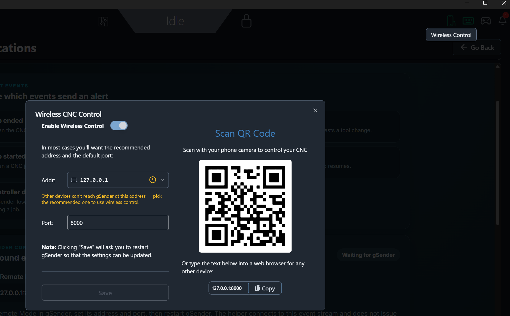
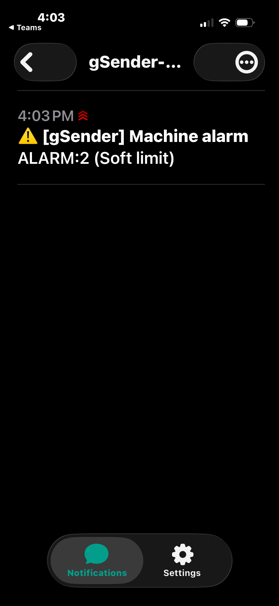

# Machine Event Notifications

**Version 0.1.19 · gSender 1.7.0-Edge-2 · Plugin SDK 0.2.2**

Configure email and/or ntfy phone push alerts for gSender machine events. A self-contained Windows service monitors gSender Wireless Control and delivers notifications in the background, even after the plugin page is closed.

## Screenshots

### Enable Wireless Control in gSender

The plugin connects to gSender using the address and port configured in the **Wireless Control** panel. In most setups, use the recommended address and port shown by gSender, then restart gSender after saving changes.



### Example ntfy alert on iPhone

The phone receives the controller alert text as the notification title, so the important machine message is visible at a glance.



## How it works

```text
gSender Wireless Control → Windows event monitor → local notification helper → email and/or ntfy
                                               ↑
                                    gSender plugin settings UI
```

The plugin stores configuration and shows helper status. The background helper listens to gSender's Wireless Control event stream and sends notifications. It does not issue G-code or motion commands. Wireless Control must be enabled; this version does not monitor machine events from gSender log files.

## Events

Job ended, machine alarm, and tool change are enabled by default. Optional alerts include job started, paused, resumed, and controller disconnected during a job. Event names and details depend on gSender and controller firmware.

## Install

The GitHub release has one download: `machine-event-email-helper-v0.1.19.zip`. This base package contains the Windows helper installer, the plugin ZIP, and this README with screenshots.

1. Download `machine-event-email-helper-v0.1.19.zip` and extract it to a folder, for example `C:\MachineEventNotifications`.
2. In the extracted folder, double-click **Install Helper.cmd** and approve the administrator prompt. The ZIP includes the Node.js runtime, monitor libraries, and NSSM; it does not download or install additional tools.
3. Copy the one-time pairing code printed by the installer.
4. In gSender, import **machine-event-email-notifier-v0.1.19.zip** from that same extracted folder and open **Machine Event Notifications**.
5. Enter the pairing code and select **Pair helper**.
6. Enable **Wireless Control** in gSender, note its address and port, then restart gSender. Enter that URL in the plugin. The usual default is `http://127.0.0.1:8000`.
7. Select the events you want. Configure email, ntfy, or both, then select **Save settings**.

The installer uses Windows PowerShell 5.1, included with Windows 10 and newer. The helper ZIP targets 64-bit Windows.
## ntfy phone notifications

1. Install [ntfy for Android](https://play.google.com/store/apps/details?id=io.heckel.ntfy) or [ntfy for iPhone](https://apps.apple.com/us/app/ntfy/id1625396347).
2. In the plugin, enable **ntfy**, keep the default server `https://ntfy.sh`, then select **Generate computer topic**. Save the settings. The generated topic uses the computer name and the last number of its Wireless Control IPv4 address, for example `gSender-GWYNN-L5-61`.
3. In the phone app, create a subscription using the same server and the exact topic shown in the plugin. This computer-name topic is predictable, not a secret. On public ntfy.sh, anyone who knows it can publish to or subscribe to it; avoid sensitive alert content or use a private ntfy server.
4. Select **Send test push**. Once it arrives on the phone, choose the alert events you want and save.

Event email and push bodies contain only the controller payload text; the event name remains in the email subject and ntfy title. The topic is stored in Windows Credential Manager with the helper's other protected settings. Do not use ntfy.sh for alerts containing information that must remain confidential. You may enter a different HTTPS ntfy server if you operate your own.

The public ntfy.sh service documents a default limit of 250 messages per day per IP; this is intended for modest alert traffic, not high-volume publishing. See the [ntfy publish documentation](https://docs.ntfy.sh/publish/) for service details and limits.

## Email configuration

Email is optional if ntfy is enabled. Gmail defaults are `smtp.gmail.com`, port `587`, and `STARTTLS`. Use the full Gmail address as the SMTP username and a Google App Password where required. The SMTP password is stored in Windows Credential Manager and is never shown by the plugin; leave its input blank to keep it unchanged.

## Settings and service management

The local helper API listens only on `127.0.0.1:1985`. SMTP credentials, ntfy settings, and event preferences are stored by the Windows helper in Credential Manager. Monitor configuration, service token, status, and logs are under `%ProgramData%\Bakstaaj\MachineEventEmailNotifier`. The Windows services are **gSender Machine Event Email API** and **gSender Machine Event Monitor**; manage them in `services.msc`.

Run **Uninstall-Helper.cmd** as administrator to remove the services. Settings and credentials remain unless you explicitly run `Uninstall-Helper.ps1 -PurgeData` from an elevated PowerShell prompt.

## Limitations and safety

- gSender Wireless Control must be enabled and reachable from the helper computer.
- Notification events and available details depend on the Wireless Control event payloads in your gSender version.
- ntfy.sh topic names are public. A random topic reduces guessability but is not private access control; anyone with the topic can read and publish to it. Use a private ntfy server for sensitive alerts.
- Phone delivery depends on ntfy, network connectivity, mobile notification permissions, and the phone's background-notification behavior.
- This is an informational alert tool, not a safety monitor or emergency notification system. Continue to supervise the CNC directly.

## Build and package

From this version folder run `npm install`, `npm run build`, `package-plugin.ps1`, and `package-helper.ps1`. The plugin ZIP contains the manifest, built UI, README, and screenshots. The helper ZIP contains the API, monitor, dependencies, portable Node.js runtime, NSSM executable, and install/uninstall scripts. Runtime notices and licenses are in `helper/runtime/RUNTIME-NOTICES.txt`.