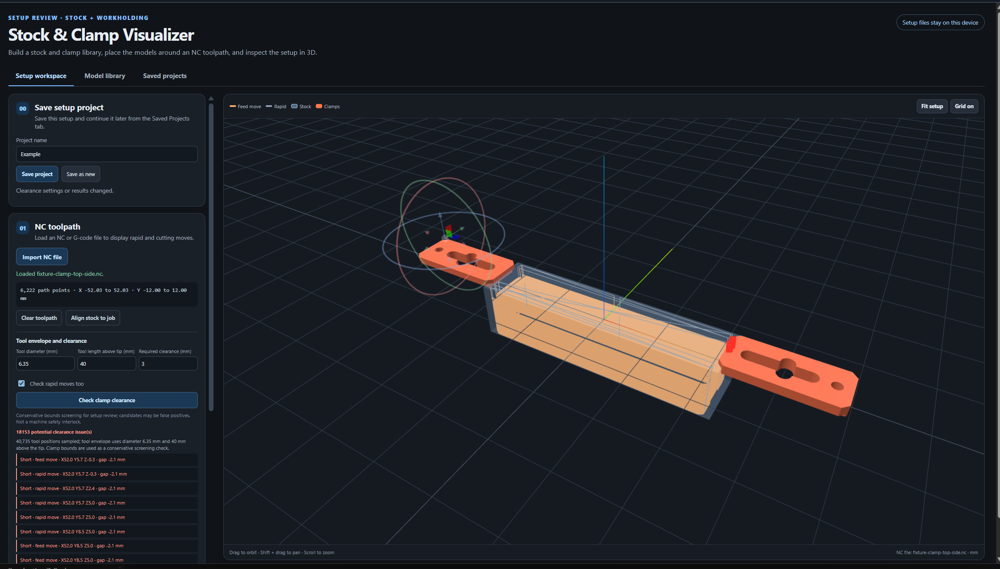

# Stock & Clamp Visualizer

**Latest release package:** [Download stock-fixture-visualizer-v0.1.1.zip](https://github.com/bakstaaj/gSender-Plugins/releases/download/stock-fixture-visualizer-v0.1.1/stock-fixture-visualizer-v0.1.1.zip)

A standalone gSender plugin for organizing stock and clamp models and reviewing their placement around an imported NC toolpath.



## Features

- Import STL and STEP/STP models into a persistent stock or clamp library.
- Use separate Setup, Model Library, and Saved Projects tabs, each with its own visualizer where relevant.
- Click stock and clamps in the setup visualizer to select them. Move and rotate parts with the on-screen controls or exact numeric fields; click empty space to clear selection.
- The model library separates stock and clamps into distinct tabs with item counts. Preview models, rename or recategorize them, add them to a setup, and delete them.
- Create parametric box and cylinder stock or clamp shapes by entering dimensions in millimeters.
- Add stock and clamp models to a setup scene. Imported geometry files are retained in this browser's IndexedDB; library and placement settings are stored in the plugin's gSender storage.
- Import an NC/G-code file and render rapid and feed moves in millimeters.
- Orbit the view through a full 360 degrees, zoom, pan with Shift + drag or right-drag, fit the scene, and toggle the grid.
- Position and rotate each stock or clamp by entering X/Y/Z and X/Y/Z angles. Stock is translucent; clamps use a separate solid color.
- Save named setup projects with their NC file, referenced model files, placements, clearance settings, and camera view. Projects remain local to this gSender browser profile.
- Export and import a portable JSON backup from the dedicated Backup & Restore tab. Backups include library model geometry, saved setups, and each project's NC toolpath. Imports merge into the current profile, keep existing items, and resolve ID conflicts without overwriting.
- On first launch in an empty gSender profile, load the included example library (11 stock and clamp models) and the Example saved project. Existing profile data is left as-is; starter content is not re-added after it has been deleted.

Export uses gSender's native Save File dialog and requires the plugin's File Save permission. Canceling the dialog does not write a file or report a successful export.
- Browse saved projects in a dedicated tab with an independent 3D preview of their stock, clamps, and NC path, then load a project back into the setup workspace for editing.
- Run a conservative toolpath-to-clamp bounds screen using a configurable tool diameter, length above the tip, and required clearance. Candidate samples are marked in the viewer.

Model coordinates are normalized to a lower-left-bottom datum when imported. Scene positions are in millimeters. **Align stock to job** matches the stock's XY minimum to the NC path bounds and places its top face at Z0. Clearance screening currently compares the tool envelope to transformed clamp bounding boxes, so it can flag false positives and is not an exact mesh collision result. Confirm setup geometry and NC interpretation independently; this plugin does not control machine motion or act as a safety interlock.

## Build

```bash
npm install
npm run build
```
