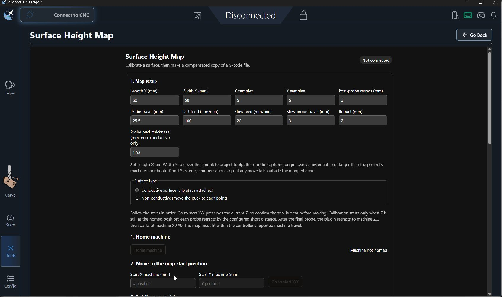
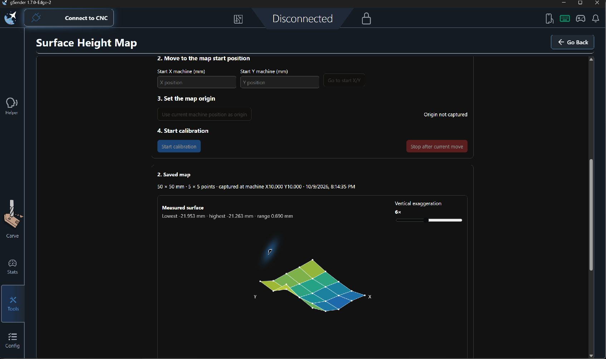
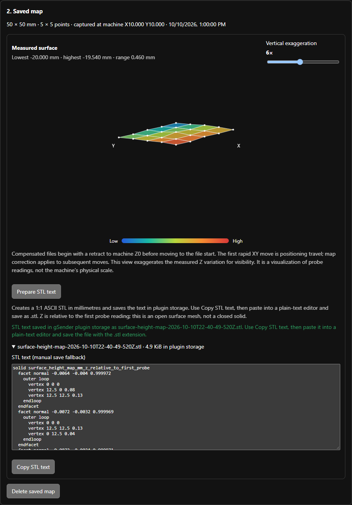

# Surface Height Map (File First)
**Latest release package:** [Download surface-height-map-file-first-v0.1.11.zip](https://github.com/bakstaaj/gSender-Plugins/releases/download/surface-height-map-file-first-v0.1.11/surface-height-map-file-first-v0.1.11.zip)

This is a separately installable gSender plugin that imports project G-code first, then derives the calibration area and sampling grid from the actual toolpath. It retains contour-aware mapping, selectable work-zero behavior, surface visualization, STL preparation, and G-code compensation.

The plugin is designed for gSender's current plugin SDK and Edge builds. It uses the supported machine query/command, plugin storage, parser, and visualizer APIs. It does not request unsupported host-side file downloads or automatic page navigation.

Version 0.1.11 anchors GRBL setting parsing to complete lines so $123 is not mistaken for $23, preserving direction and travel bounds. It also retries incomplete controller settings reads and reports the `$23` mask and chosen X/Y direction in the calibration status before probing. Version 0.1.9 fixes the `$23` to machine-coordinate sign mapping for positive-homing directions; with `$23=3`, X/Y map points extend toward positive machine coordinates. Version 0.1.8 reads `$23` to determine signed X/Y machine-coordinate travel and map direction, keeping probing and compensation aligned with the controller homing configuration. Version 0.1.7 detects gSender's existing homing state and skips the homing cycle when the machine is already homed. It adopts the current machine Z as the retract baseline, uses gSender's status stream for position reads, and limits each probe move to safe available Z travel. It also falls back to the stopped gSender machine position if a successful probe's `[PRB:...]` report is missing, and adds Conductive, Puck, and Switch probe types. Version 0.1.6 fixes the no-perimeter fallback with an in-plugin choice to use the file-bound rectangle or cancel. Version 0.1.5 added contour-aware probing and selectable work-zero behavior. When a closed G-code perimeter is found, the largest closed loop is previewed and probed at points no more than 10 mm apart; the usual rectangular grid is added only at points inside that contour. If no closed perimeter is detected, a prompt offers the existing rectangular grid. Contour maps reject compensation moves outside the probed boundary. During application, either rebase the generated copy around a selected file XY point or preserve its coordinates and place that file point at a selected machine XY location. Version 0.1.4 added calibration percentage and recent probe readings. Version 0.1.3 added saved-scan reuse, and version 0.1.2 added zero or centered probe-area alignment.

## Workflow

1. **Import the project.** Choose the project G-code file. The plugin requires metric (`G21`) and absolute (`G90`) XY coordinates. It looks for explicitly closed linear G-code contours. The largest closed loop is treated as the stock perimeter and shown in a preview; verify it matches the material before probing. If no suitable loop is present, an in-plugin dialog offers **Use rectangle from min/max**. Selecting it derives the rectangular probe area from the file’s minimum and maximum X/Y points; this can probe outside irregular stock. Select **Cancel** to stop analysis. After choosing a mapping mode, connect to the CNC before checking project fit and machine limits.
2. **Choose the probe-area alignment and check the machine envelope.** Choose **Start at machine X0 Y0** to map the project's minimum X/Y to machine zero, or **Center project on machine travel** to place the project-sized probe area symmetrically around the travel midpoint. `$23` determines the signed machine-coordinate ranges and the direction the map extends away from each homing end. The plugin calculates project width and height from its smallest and largest absolute coordinates and checks the full area against those ranges.
3. **Review the probe pattern.** For a detected perimeter, perimeter samples are evenly spaced at no more than 10 mm along each edge; the regular grid is added only where its points lie inside the perimeter. Duplicate points are removed. In rectangular fallback mode, the existing grid remains at no more than 10 mm spacing and at least 50 points. Review the outline preview and machine travel before homing.
4. **Confirm the machine is homed.** If gSender reports the machine already homed, the plugin skips re-homing and records the current machine Z as its retract baseline. Confirm Z is clear and safe before moving. Otherwise, click **Home machine**; the plugin verifies machine X0 Y0 and records the resulting Z baseline. The map origin is derived from the imported file and selected zero or centered alignment. Every generated probe point is checked against machine limits.
5. **Start calibration and supervise.** Click **Start calibration**. Calibration automatically moves through the generated probe points, beginning at the first point in the derived grid; there is no separate origin-capture action. Before each fast and slow probe, the plugin checks available downward Z travel and caps the move short of the machine Z limit. Conductive prompts once to confirm the clip is attached; Puck pauses at each point for puck placement and subtracts its thickness; Switch probes automatically without a clip prompt. The progress bar shows a percentage as probe points complete. The live table shows the latest ten readings, newest first, with machine X/Y, absolute machine Z, and Z offset relative to the first probe point. Stay with the CNC during every move.
6. **Choose work zero and apply.** Select **Rebase copy around selected file point** to make the entered file X/Y become X0/Y0 in the generated copy, or select **Keep file coordinates; place selected point at machine XY** to leave file coordinates intact and set the selected point's machine placement through G54. For contour maps, every compensated interpolation point must remain inside the scanned perimeter or preflight stops before G54 is changed. G54 persists and affects other G54 jobs until changed again. The source file remains untouched; the compensated copy is loaded into the visualizer. Open Carve manually to review it.

With zero alignment, the project's minimum X/Y maps to machine X0 Y0 and the grid extends away from each homing end according to `$23`. With center alignment, the project width and height define a centered probe area within the signed machine travel. The controller must be homed, and the full probe area must be clear in either mode. The plugin uses the current machine Z when it detects an existing homed state; verify that position is safe before starting.

## Screenshots

These captures show earlier rectangular-map and saved-map/STL panels. They predate the v0.1.5 contour preview and work-zero controls and the v0.1.7 homing-aware calibration panel; refer to the workflow above for the current behavior.

### Rectangular map setup

This earlier setup screen illustrates the existing rectangular map controls. In v0.1.5, the project dimensions and grid are derived from the uploaded G-code, and the rectangle is offered as a fallback when no closed perimeter is found.



### Saved surface map

The saved map panel visualizes measured surface variation. Contour maps in v0.1.5 display the detected perimeter and sampled points.



### STL export

The export panel prepares ASCII STL text in plugin storage and provides the manual copy workflow.




## Settings

The plugin keeps its settings separately from the existing plugin because it has its own identifier and storage namespace.

| Setting | Behavior in this workflow |
| --- | --- |
| Length X / Width Y | Set from the imported file's max-min X/Y bounds after machine travel validation. |
| X / Y samples | Automatically computed: no more than 10 mm between adjacent points and at least 50 grid points total. |
| Probe area alignment | Saved selection between aligning project minimum to machine X0 Y0 and centering the project extents on machine XY travel. `$23` sets each map axis direction. |
| Contour mode | Uses the largest explicitly closed G0/G1 loop; perimeter pitch is capped at 10 mm and interior grid points are clipped to the polygon. |
| Work-zero method | Rebase the copy around a selected file coordinate, or preserve coordinates and place that point at selected machine XY. |
| Post-probe retract | Preserved from this plugin's settings; defaults to 3 mm on a fresh install. |
| Probe travel | Preserved; fresh-install default is 25.5 mm. |
| Fast feed / Slow feed | Preserved; fresh-install defaults are 100 / 20 mm/min. |
| Slow probe travel / Interim retract | Preserved; fresh-install defaults are 3 / 2 mm. |
| Probe type / Probe puck thickness | Conductive, Puck, or Switch. Puck thickness is displayed and applied only for Puck probing. |

File coordinates are not rewritten when the project is loaded into the plugin. During **Apply map**, the plugin calculates the persistent G54 offset that moves the file's minimum X/Y to the selected map origin. Review the confirmation and the loaded visualizer copy before running any job.

## Requirements and limitations

- A live connection to the CNC is required to import and validate a project against controller `$130`/`$131`/`$132` limits. If the file is selected while disconnected, connect and click **Check project and machine limits**. Redux read permission lets the plugin read gSender's homing state and current machine position.
- Input G-code must explicitly use metric units and absolute positioning before XY coordinates. The compensation stage retains the same supported G-code subset documented by the original plugin: metric, absolute linear G0/G1 toolpaths that fit the map.
- The controller must accept `G38.2`, report successful `[PRB:...]` positions, and have a verified probe input.
- When the plugin runs a new homing cycle, the controller must report machine X0 Y0. Center alignment changes where the probe grid is placed; it does not redefine the controller's home coordinates.
- Grid generation rejects a project with zero width or height, a project outside machine XY travel, or more than 101 samples on either axis. Contour detection supports closed, metric, absolute linear G-code loops; arcs are not used to infer a perimeter. The selected largest loop is a G-code candidate, so verify the preview against the actual stock edge.
- STL preparation uses plugin storage; it does not save directly to Downloads. Each stored value is limited by the current gSender plugin bridge to 256 KiB. Copy the generated STL text into a plain-text editor and save it using the shown `.stl` filename.
- The plugin does not automatically navigate to Carve because that is not available through the Edge API version targeted here.

## Install and build

In gSender, install the plugin ZIP from this plugin's `dist/` directory. It appears as **Surface Height Map (File First)**, alongside the original plugin.

For standalone source development, use Node.js 18+:

```sh
npm install
npm test
npm run build
```

The build uses the published `@sienci/gsender-plugin-sdk` package, so it does not need a gSender source checkout.

Then package the built plugin:

```powershell
./package-plugin.ps1
```

The packager creates `dist/surface-height-map-file-first-v<version>.zip`. Version `0.1.9` has its own plugin ID, route, storage, and settings.

## Safety

Homing, XY moves, probing, G54 changes, and compensated G-code are machine operations. Verify machine travel, the probe circuit, clearances, tool height, and G54 readback. Keep the spindle off for the first air-move check, supervise calibration in person, and review the complete toolpath in the visualizer before cutting. This workflow is an experiment for testing; a successful software preflight does not prove physical safety.
