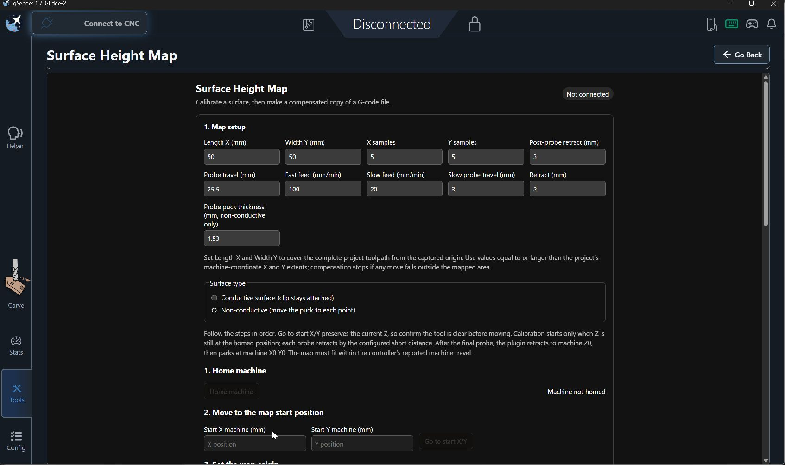
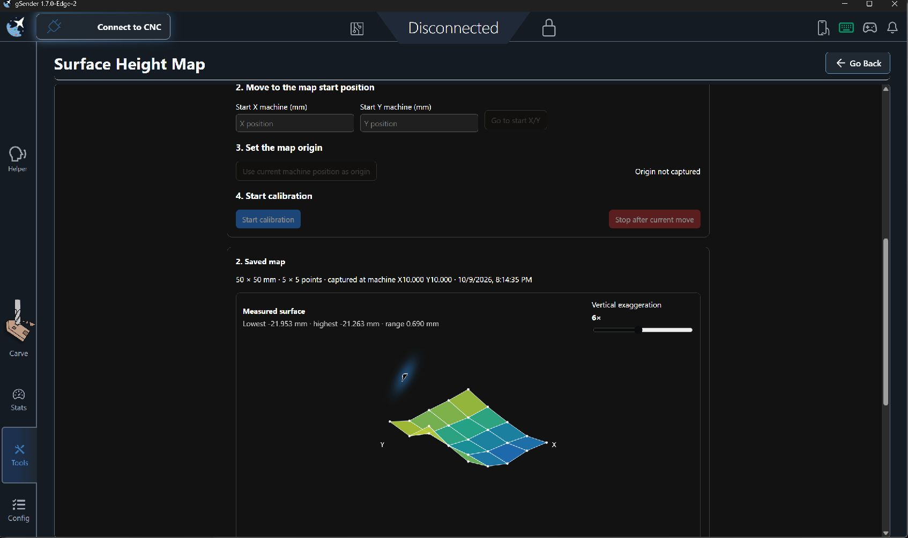
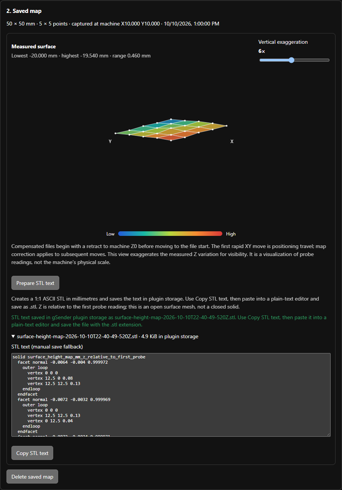

# Surface Height Map (File First)
**Latest release package:** [Download surface-height-map-file-first-v0.1.12.zip](https://github.com/bakstaaj/gSender-Plugins/releases/download/surface-height-map-file-first-v0.1.12/surface-height-map-file-first-v0.1.12.zip?updated=20261102)

This is a separately installable gSender plugin that imports project G-code first, then derives the calibration area and sampling grid from the actual toolpath. It retains contour-aware probing, selectable work-zero behavior, surface visualization, STL preparation, and G-code compensation. The updated workflow establishes a G54 WPOS origin before calibration and extends measured edges into unprobed machine travel; WPOS Z0 remains the compensation reference.

The plugin is designed for gSender's current plugin SDK and Edge builds. It uses the supported machine query/command, plugin storage, parser, and visualizer APIs. It does not request unsupported host-side file downloads or automatic page navigation.

Version 0.1.12 adds the WPOS-first calibration workflow: home only when gSender does not already report homed, choose a corner or center origin, jog into position, and probe to set G54 X0 Y0 Z0. Fast probe travel is calculated from the available Z travel; the fixed short retract is 3 mm and the fixed slow second-touch travel is 3.5 mm. Full Retract Height is measured above WPOS Z0. Calibration retains contour and interior sampling. The saved map extends across the machine XY travel from $130/$131: rectangular edge strips extend from the nearest measured row or column, and their corners extrapolate along 45-degree diagonals. Contour maps extend from their nearest probe readings. The surface display is an isometric view with the chosen (0,0) marker and X/Y edge labels. A persistent calibration log records controller commands and results. Previous features include contour-aware project analysis, file-first work-zero selection, live probe readings, STL text preparation, homing-state detection, signed `$23` machine travel, and G-code compensation.

## Workflow

1. **Import and check the project.** Choose the metric, absolute G-code file and inspect the perimeter preview. The plugin derives dimensions and sampling from a closed contour or the file-bound rectangle. It reads `$23` and `$130/$131/$132`, then checks that the project can fit in the machine envelope.
2. **Set probe parameters.** Choose Conductive, Puck, or Switch. Enter feeds and Full Retract Height. Fast probe travel is calculated automatically from current machine Z and `$132` with a safety margin. The plugin uses a fixed 3 mm short retract followed by a fixed 3.5 mm slow second touch.
3. **Home and position the probe.** If gSender reports the machine is homed, that step is already satisfied. Otherwise use **Home machine** in the jog panel. Select the material corner or center for WPOS X0 Y0, choose a jog step or Continuous (hold), and jog the probe over that point.
4. **Probe WPOS origin.** Use **Probe WPOS origin** under Z−. The plugin probes the surface, sets G54 WPOS X0 Y0 Z0, and moves to Full Retract Height. The captured origin sets the actual machine placement of the file-derived probe pattern.
5. **Start calibration.** The plugin checks every generated point against `$23` travel, moves to the material grid, then scans front-left to back-right. Conductive prompts once for clip confirmation; Puck pauses at every point and applies its thickness; Switch probes without a clip prompt. The latest ten readings and percent complete remain visible, and the calibration log records controller commands and replies. After probing, the map covers full machine XY travel; rectangular edges continue from their measured rows and columns, and corners extrapolate along 45-degree diagonals. The isometric plot marks the selected (0,0) and keeps X to the right and Y to the left.
6. **Choose work zero and apply.** Select **Rebase copy around selected file point** or **Keep file coordinates; place selected point at machine XY**. The plugin checks the transformed toolpath against machine travel, updates saved G54 X/Y when needed, leaves the source untouched, and loads a compensated copy into the visualizer. Open Carve manually to review it.

The selected origin may be at any of the four stock corners or the center. `$23` supplies signed machine travel directions. Full Retract Height must remain within Z travel. Verify the probe location, tool clearance, and projected machine travel before starting.

## Screenshots

These captures show earlier rectangular-map and saved-map/STL panels. They predate the v0.1.5 contour preview and work-zero controls and the v0.1.7 homing-aware calibration panel; refer to the workflow above for the current behavior.

### Rectangular map setup

This earlier setup screen illustrates the existing rectangular map controls. In v0.1.5, the project dimensions and grid are derived from the uploaded G-code, and the rectangle is offered as a fallback when no closed perimeter is found.



### Saved surface map

The saved map panel visualizes measured surface variation. Contour maps in v0.1.5 display the detected perimeter and sampled points.



### STL export

The export panel prepares ASCII STL text in plugin storage and provides the manual copy workflow.




## Settings

The plugin keeps its settings separately from the existing plugin because it has its own identifier and storage namespace.

| Setting | Behavior in this workflow |
| --- | --- |
| Length X / Width Y | Set from the imported file's max-min X/Y bounds after machine travel validation. |
| X / Y samples | Automatically computed: no more than 10 mm between adjacent points and at least 50 grid points total. |
| WPOS origin | Saved selection of front/rear, left/right, or center; the first probe establishes G54 X0 Y0 Z0. `$23` sets each map axis direction. |
| Contour mode | Uses the largest explicitly closed G0/G1 loop; perimeter pitch is capped at 10 mm and interior grid points are clipped to the polygon. |
| Work-zero method | Rebase the copy around a selected file coordinate, or preserve coordinates and place that point at selected machine XY. |
| Full Retract Height | Positive clearance above WPOS Z0, used for XY travel between probe points. |
| Fast probe travel | Calculated at each probe from available machine Z travel and capped with a safety margin. |
| Fast feed / Slow feed | Preserved; fresh-install defaults are 100 / 20 mm/min. |
| Short retract / slow second touch | Both values are fixed in software: 3 mm retract to release the probe, then up to 3.5 mm of slower downward travel to re-contact the surface. |
| Probe type / Probe puck thickness | Conductive, Puck, or Switch. Puck thickness is displayed and applied only for Puck probing. |

File coordinates are not rewritten when the project is loaded into the plugin. During **Apply map**, the plugin calculates the persistent G54 offset that moves the file's minimum X/Y to the selected map origin. Review the confirmation and the loaded visualizer copy before running any job.

## Requirements and limitations

- A live connection to the CNC is required to import and validate a project against controller `$130`/`$131`/`$132` limits. If the file is selected while disconnected, connect and click **Check project and machine limits**. Redux read permission lets the plugin read gSender's homing state and current machine position.
- Input G-code must explicitly use metric units and absolute positioning before XY coordinates. The compensation stage retains the same supported G-code subset documented by the original plugin: metric, absolute linear G0/G1 toolpaths that fit the map.
- The controller must accept `G38.2`, report successful `[PRB:...]` positions, and have a verified probe input.
- When the plugin runs a new homing cycle, the controller must report machine X0 Y0. Center alignment changes where the probe grid is placed; it does not redefine the controller's home coordinates.
- Grid generation rejects a project with zero width or height, a project outside machine XY travel, or more than 101 samples on either axis. Contour detection supports closed, metric, absolute linear G-code loops; arcs are not used to infer a perimeter. The selected largest loop is a G-code candidate, so verify the preview against the actual stock edge.
- STL preparation uses plugin storage; it does not save directly to Downloads. Each stored value is limited by the current gSender plugin bridge to 256 KiB. Copy the generated STL text into a plain-text editor and save it using the shown `.stl` filename.
- The plugin does not automatically navigate to Carve because that is not available through the Edge API version targeted here.

## Install and build

In gSender, install the plugin ZIP from this plugin's `dist/` directory. It appears as **Surface Height Map (File First)**, alongside the original plugin.

For standalone source development, use Node.js 18+:

```sh
npm install
npm test
npm run build
```

The build uses the published `@sienci/gsender-plugin-sdk` package, so it does not need a gSender source checkout.

Then package the built plugin:

```powershell
./package-plugin.ps1
```

The packager creates `dist/surface-height-map-file-first-v<version>.zip`. Version `0.1.9` has its own plugin ID, route, storage, and settings.

## Safety

Homing, XY moves, probing, G54 changes, and compensated G-code are machine operations. Verify machine travel, the probe circuit, clearances, tool height, and G54 readback. Keep the spindle off for the first air-move check, supervise calibration in person, and review the complete toolpath in the visualizer before cutting. This workflow is an experiment for testing; a successful software preflight does not prove physical safety.
