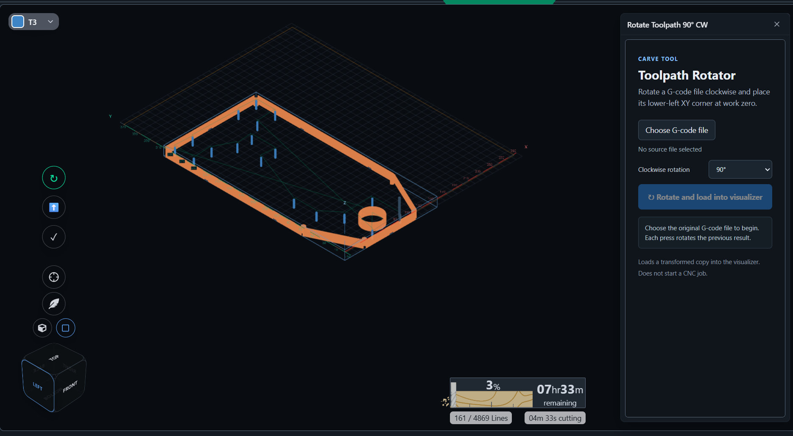

# Toolpath Rotator v0.1.0

**Download:** [toolpath-rotator-v0.1.0.zip](https://github.com/bakstaaj/gSender-Plugins/releases/download/toolpath-rotator-v0.1.0/toolpath-rotator-v0.1.0.zip)

Toolpath Rotator adds a button to the gSender Carve visualizer. It rotates a selected G-code file clockwise around Z by 90°, 180°, or 270°, moves the toolpath's lower-left XY bound to work position X0 Y0, and loads the transformed copy into the visualizer.

## Use

1. Open **Rotate Toolpath 90° CW** from the Carve visualizer overlay buttons.
2. Choose the source G-code file. The plugin SDK does not expose a supported way for this plugin to read the visualizer's already loaded file, so select the same file you loaded in Carve.
3. Choose **90°**, **180°**, or **270°** clockwise.
4. Click **Rotate and load into visualizer**. The transformed copy replaces the visualizer's current file. Choose another angle and click again to rotate the latest result again.
5. Review the complete toolpath in Carve before sending a job. The plugin only loads the file into the visualizer; it does not start a CNC job.

The rotation is applied to XY positions and I/J arc-center offsets. Arc direction is reversed for 90° and 270° rotations; 180° preserves the direction. Z values, feeds, spindle commands, and other non-XY words are retained. The toolpath is rebased after rotation so its minimum X and minimum Y are both zero in the file's active work coordinate system.

## Supported G-code

- Inch (`G20`) and metric (`G21`) coordinates, as long as the file uses one consistent unit mode.
- Absolute positioning (`G90`) in the XY plane (`G17`).
- Linear XY moves and I/J-center arcs with incremental arc centers (`G91.1`, the usual default).

The plugin reports an error instead of transforming incremental positioning (`G91`), other planes, absolute arc centers (`G90.1`), radius-form arcs (`R`), or arcs without usable I/J center offsets. It uses the full XY path envelope, including cardinal extrema along supported arcs, when finding the lower-left corner.

## Build

Run `npm ci`, `npm run build`, then `./package-plugin.ps1` from this version folder. The release ZIP includes the manifest, README, and built `ui/` directory.
